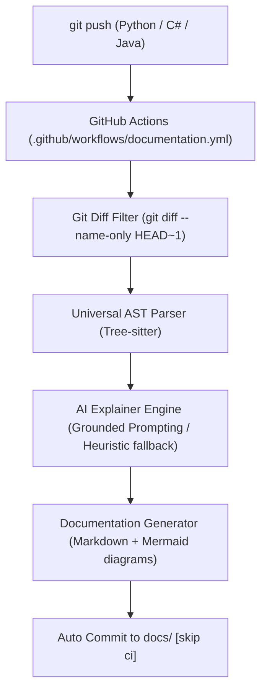

# Automated Multi-Language Code Documentation Pipeline

An end-to-end, multi-language automated architectural documentation generator powered by **Tree-sitter AST parsing**, **AI Semantic Grounding**, and **GitHub Actions**.

Whenever developers push code in **Python**, **C#**, or **Java** (with TypeScript/JS easily expandable), this pipeline automatically extracts classes, methods, parameters, and inheritance, explains the architectural *reasoning* and *purpose*, and publishes structured Markdown documents with **Mermaid.js class diagrams**.

---

## 🏗️ Architecture Overview



---

## 🚀 Key Features

1. **Universal Polyglot Parser**:
   - Deterministic AST extraction using official `tree-sitter` grammars for Python, C# (.NET), and Java.
   - Extracts Class Names, Inheritance (`extends`/`implements`), Constructor Dependency Injections, and Method Signatures.
2. **Infinite Loop Protection**:
   - Workflow uses `paths-ignore: ['docs/**']` and commits using `[skip ci]` to prevent recursive GitHub Actions execution.
3. **Incremental Git Diff Scanning**:
   - Only parses files touched in the latest commit (`--diff` flag), keeping CI runs ultra-fast and preventing API rate-limit exhaustion.
4. **Offline / Fallback Capability**:
   - Works 100% out of the box even without an external LLM API key using the built-in grounded heuristic engine. When `LLM_API_KEY` is supplied, it provides deeper natural language explanations.
5. **Interactive Visual Diagrams**:
   - Automatically generates Mermaid.js class diagrams with inheritance and dependency connections.

---

## 📁 Repository Structure

```text
Github-Pipeline/
├── .github/
│   └── workflows/
│       └── documentation.yml       # Production GitHub Actions workflow
├── analyzer/
│   ├── __init__.py
│   ├── main.py                     # CLI orchestrator & entry point
│   ├── parser.py                   # Universal Tree-sitter AST parser
│   ├── ai_engine.py                # Grounded AI & fallback explanation engine
│   ├── doc_generator.py            # Markdown & Mermaid diagram generator
│   ├── models/                     # Data contracts & Pydantic schemas
│   │   ├── __init__.py
│   │   └── schemas.py              # ClassMetadata, MethodMetadata, etc.
│   └── utils/                      # Helper utilities
│       ├── __init__.py
│       └── git_utils.py            # Git diff detection & directory scanner
├── tests/                          # Automated test suite & test sample code
│   ├── __init__.py
│   ├── test_pipeline.py            # Unittest suite for parser & generator
│   └── sample_code/                # Multi-language test files
│       ├── order_manager.py        # Python sample
│       ├── OrderService.cs         # C# sample
│       └── PaymentProcessor.java   # Java sample
├── docs/                           # Auto-generated documentation directory
│   ├── README.md                   # Class catalog index
│   └── architecture/               # Language-specific markdown docs
├── requirements.txt
└── README.md
```

---

## 🛠️ Local Usage

### 1. Install Dependencies
```bash
pip install -r requirements.txt
```

### 2. Run Local Documentation Generation
To scan all files across the repository:
```bash
python analyzer/main.py --all
```

To scan only files modified in the latest git commit:
```bash
python analyzer/main.py --diff
```

To scan a specific file or folder:
```bash
python analyzer/main.py --path sample_project/OrderService.cs
```

### 3. Optional: Configure LLM API Key
To enable deep LLM semantic explanations, create a `.env` file:
```env
LLM_API_KEY=your_api_key_here
LLM_MODEL=gpt-4o-mini
```
*(If no API key is provided, the engine runs in 100% free deterministic heuristic mode).*

---

## 🔒 GitHub Actions Secrets Configuration

To run with hosted LLMs in GitHub Actions:
1. Go to your repository on GitHub: **Settings > Secrets and variables > Actions**.
2. Click **New repository secret**.
3. Add `LLM_API_KEY` with your OpenAI / Gemini / OpenRouter API key.
4. Workflow permissions are pre-configured to `contents: write`.
