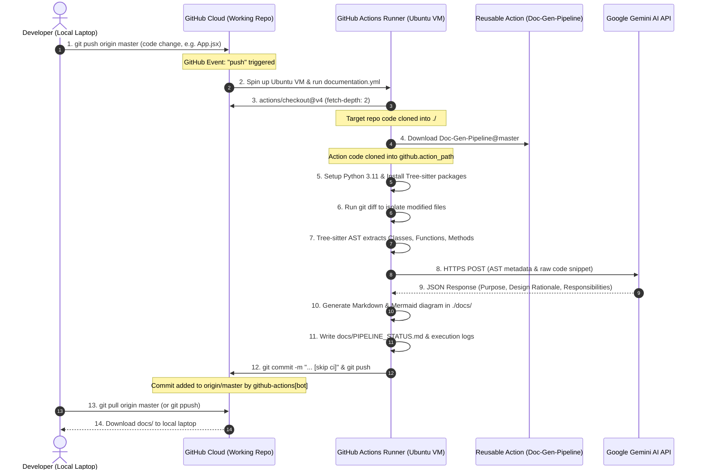

# 📘 Automated Code Documentation Pipeline: Complete Architecture & Flow Guide

---

## 1. Executive Summary

The **Automated Code Documentation Pipeline (`Doc-Gen-Pipeline`)** is an enterprise-grade, zero-configuration CI/CD solution that converts source code changes into clean, structured Markdown documentation with interactive Mermaid class architecture diagrams. 

It is designed as a **Reusable GitHub Composite Action**, allowing any consumer repository (e.g., `Sample-Project-GP`, `Sample-Project-GP-2`) to inherit automated documentation capabilities with a simple 2-step workflow file and zero local dependency overhead.

---

## 2. Technology Stack Breakdown

| Layer | Technology | Purpose & Implementation Details |
| :--- | :--- | :--- |
| **AST Parsing Engine** | **Tree-sitter** (C-based parser generators) | Multi-language syntax parsing without executing untrusted code. Supports **8 language targets**: Python, C#, Java, JavaScript, JSX (React), TypeScript, TSX, Go, and Rust. |
| **AI Explanation Engine** | **Google Gemini 3.5 Flash** (`gemini-3.5-flash`) | Analyzes AST metadata and raw code to generate structured architectural rationale, component responsibilities, and parameter explanations. |
| **Deterministic Fallback Engine** | **Grounded Heuristic Engine** | In-house rule-based AST explainer that automatically activates if API rate limits (HTTP 429), quota exhaustion, or network timeouts occur. Ensures 100% pipeline reliability with zero downtime. |
| **Data Validation & Schemas** | **Pydantic v2** | Enforces strict type schemas (`ClassMetadata`, `MethodMetadata`, `ClassExplanation`, `AppConfig`) for clean data serialization between AST, AI, and Markdown generators. |
| **Visualization & Diagrams** | **Mermaid.js** | Generates class inheritance, method signatures, properties, and relationship diagrams embedded directly inside Markdown artifacts. |
| **CI/CD Orchestration** | **GitHub Actions (Composite Action)** | Runs in isolated cloud Ubuntu runners. Self-contained environment that auto-provisions Python 3.11, installs Tree-sitter packages, parses diffs, and commits documentation. |
| **Git Automation** | **Git CLI & GitHub Actions Bot** | Incremental scanning via `git diff HEAD~1 HEAD`, automated authoring by `github-actions[bot]`, and loop prevention using `[skip ci]`. |
| **Storage & Log Management** | **PipelineLogger (Multi-Channel)** | Multi-directory logging (`err_log`, `fn_log`, `quota_complete_log`) featuring dual-threshold automatic cleanup (1-hour time window + 10MB size ceiling). |

---

## 3. End-to-End Background Lifecycle & Communication Flow



---

## 4. Phase-by-Phase Execution Details

### Phase 1: The Push Event & Trigger
1. The developer pushes code to GitHub (`git push origin master`).
2. GitHub's webhook engine catches the push event.
3. Because the commit modifies files outside the ignored paths (`paths-ignore`), GitHub launches the workflow defined in `.github/workflows/documentation.yml`.

### Phase 2: Target Repository Checkout
* **Action**: `actions/checkout@v4` with `fetch-depth: 2`.
* **Why `fetch-depth: 2`?**: Default git checkout fetches only the current commit (`depth: 1`). Fetching depth 2 ensures git diff (`git diff HEAD~1 HEAD`) can compare the current commit against its parent to identify exactly which files were modified.

### Phase 3: Composite Action Resolution
* **Directive**: `uses: jerry-fab/Doc-Gen-Pipeline@master`.
* The runner pulls the reusable pipeline repository into a dedicated action directory (`github.action_path`).
* Target projects do **not** need to maintain Python dependencies or parser scripts in their own codebase.

### Phase 4: AST Extraction (Tree-sitter)
* The parser scans source files without compiling or executing them:
  - **React JSX/TSX**: Discovers functional components (`function App()`, `const Home = () => ...`) and ES6 classes.
  - **Python, Java, C#**: Discovers classes, inheritance hierarchies, method signatures, parameter types, and docstrings.
  - **Go & Rust**: Discovers structs, receiver methods, trait implementations, and public modules.

### Phase 5: AI Explanation Engine (Gemini 3.5 Flash)
* AST metadata and source code are sent to Google Gemini via:
  - **Endpoint**: `https://generativelanguage.googleapis.com/v1beta/openai/chat/completions`
  - **Model**: `gemini-3.5-flash`
  - **Prompt Engineering**: Instructs the model to output strict JSON covering:
    - Primary purpose
    - Inferred design rationale
    - Architectural responsibilities
    - Key methods and injected dependencies
* **Fault Tolerance**: If Google returns HTTP 429, 404, or 503, the pipeline automatically falls back to the internal `GROUNDED_HEURISTIC` engine.

### Phase 6: Documentation Synthesis & Status Logging
* **Output Path**: `./docs/architecture/<Language>/<ClassName>.md`
* **Root Index**: Updated at `./docs/README.md`.
* **Execution Logs**:
  - `docs/PIPELINE_STATUS.md`: Live Markdown status dashboard (Start time, completion duration, components documented, engine used).
  - `docs/pipeline_execution.log`: Historical audit log of every pipeline execution.

### Phase 7: Automated Commit & Infinite Loop Prevention
* Git stages all artifacts in `docs/`.
* The commit is authored by:
  ```text
  Author: github-actions[bot] <github-actions[bot]@users.noreply.github.com>
  Message: docs: auto-update class architecture documentation [skip ci]
  ```
* 🛡️ **Loop Prevention Architecture**:
  1. **`[skip ci]` tag**: Tells GitHub Actions runner to skip triggering builds on this commit.
  2. **`paths-ignore: - 'docs/**'`**: Tells the workflow to ignore any push that only alters documentation.

### Phase 8: Local Workspace Synchronization
* The commit lands on GitHub remote repository (`origin/master`).
* When the developer runs `git pull origin master` (or uses the automated alias `git ppush`), the newly generated `docs/` folder transfers from GitHub cloud directly into the local IDE workspace.

---

## 5. Storage & Log Retention System

To prevent disk saturation during high-frequency CI/CD runs, the pipeline features a **Dual-Threshold Automatic Purge Engine** inside `analyzer/utils/logger.py`:

```json
"logging": {
  "max_age_hours": 1,
  "max_size_mb": 10
}
```

1. **Time-Based Purge (`max_age_hours: 1`)**:
   - Inspects timestamped logs across `logs/err_log/`, `logs/fn_log/`, and `logs/quota_complete_log/`.
   - Any log file older than 1 hour (3,600 seconds) is automatically removed upon pipeline initialization.
2. **Size-Based Purge (`max_size_mb: 10`)**:
   - If total log directory volume exceeds the configured MB threshold (default: 10MB), older logs are purged starting from the oldest until total volume drops beneath the threshold.
   - Actively running session log files are always protected.

---

## 6. Developer Synchronization & Setup Guide

### ⚠️ Critical Architectural Disclaimer: Manual `git pull` Required
> [!IMPORTANT]
> Generated documentation artifacts are created inside the cloud GitHub Actions Ubuntu runner and committed **DIRECTLY** to the remote GitHub cloud repository by `github-actions[bot]`.
> 
> Because Git is a distributed version control system, cloud commits **DO NOT** automatically transfer to your local development machine. After pushing code, allow approximately **25-30 seconds** for the cloud action to complete, and then manually run the pull command in your local terminal to retrieve the newly generated docs:
> ```bash
> git pull origin master   # or: git pull origin <your-branch>
> ```

---

---

## 6. Setting Up in GitHub Cloud Server vs Local Server

The pipeline can be operated in two distinct environments: **GitHub Cloud-Hosted Runners** and **Local / Self-Hosted Servers**.

### 6.1 Environment Comparison Matrix

| Architectural Parameter | GitHub Cloud Server (Standard) | Local Server / Self-Hosted Runner |
| :--- | :--- | :--- |
| **Execution Host** | Ephemeral Ubuntu VM hosted in GitHub cloud (Azure/AWS) | Your local PC, on-premise physical server, or private VM |
| **Runner Directive** | `runs-on: ubuntu-latest` | `runs-on: self-hosted` (or `[self-hosted, windows]`) |
| **Network Requirements** | Public internet access to GitHub and Gemini API | Can run behind corporate proxies / intranet / local LLMs |
| **Setup Overhead** | Zero-setup (automatic runner spinning) | Requires registering self-hosted runner in GitHub settings |
| **Cost / Limits** | Uses GitHub Actions monthly free/paid minutes | Free (utilizes your local server's existing CPU compute) |

---

## 7. How `documentation.yml` Changes for Cloud vs Local Setup

Depending on the host environment and repository type, the workflow file adapts as follows:

### Scenario A: GitHub Cloud Server (Target Consumer Repositories)
Used by any consumer repository (e.g. `Sample-Project-GP`, `Sample-Project-GP-2`) running in standard GitHub Cloud:

```yaml
# .github/workflows/documentation.yml (Cloud Runner for Target Projects)
name: Automated Code Documentation Pipeline

on:
  push:
    branches: [ main, master ]
    paths-ignore:
      - 'docs/**'
      - 'logs/**'
      - '*.md'
      - '.gitignore'
  workflow_dispatch:

permissions:
  contents: write

jobs:
  generate-docs:
    runs-on: ubuntu-latest    # <-- GITHUB CLOUD HOSTED VM
    name: Execute Code Documentation Action

    steps:
      - name: Checkout Repository
        uses: actions/checkout@v4
        with:
          fetch-depth: 2

      - name: Run Documentation Action
        uses: jerry-fab/Doc-Gen-Pipeline@master    # <-- REFERENCES REMOTE REPO
        with:
          output_dir: 'docs'
          commit_message: 'docs: auto-update class architecture documentation [skip ci]'
```

---

### Scenario B: GitHub Cloud Server (Action Pipeline Repo Itself)
Used exclusively inside `jerry-fab/Doc-Gen-Pipeline` to execute its root `action.yml` directly:

```yaml
# .github/workflows/documentation.yml (Inside Doc-Gen-Pipeline Repo)
    steps:
      - name: Checkout Repository
        uses: actions/checkout@v4
        with:
          fetch-depth: 2

      - name: Run Documentation Action
        uses: ./    # <-- INVOKES LOCAL ROOT action.yml DIRECTLY
        with:
          output_dir: 'docs'
```

---

### Scenario C: Local Server (Self-Hosted GitHub Actions Runner)
Used when you register your local workstation or company on-premise server as a GitHub Self-Hosted runner:

```yaml
# .github/workflows/documentation.yml (Self-Hosted Local Server)
jobs:
  generate-docs:
    runs-on: self-hosted    # <-- RUNS LOCALLY ON YOUR ON-PREMISE MACHINE
    name: Execute Code Documentation on Local Server

    steps:
      - name: Checkout Repository
        uses: actions/checkout@v4
        with:
          fetch-depth: 2

      - name: Run Documentation Action
        uses: jerry-fab/Doc-Gen-Pipeline@master
        with:
          output_dir: 'docs'
          commit_message: 'docs: auto-update class architecture documentation [skip ci]'
```

---

### Scenario D: Pure Local CLI Execution (Without GitHub Actions)
If you want to run documentation immediately on your local machine without pushing to GitHub:

```bash
# In your local project terminal:
# 1. Analyze only files modified in the latest Git commit:
python analyzer/main.py --diff --output-dir docs

# 2. Or recursively scan the entire project workspace:
python analyzer/main.py --all --output-dir docs
```

---

## 8. Setup Process & Configuration

### Step 1: Create the Workflow File
In the root of your target workspace repository, create `.github/workflows/documentation.yml` using the appropriate scenario from above (usually Scenario A).

### Step 2: Enable GitHub Actions Write Permissions
In your target GitHub repository:
1. Navigate to **Settings** > **Actions** > **General**.
2. Scroll down to **Workflow permissions**.
3. Select **"Read and write permissions"** (allows `github-actions[bot]` to commit docs).
4. Click **Save**.

### Step 3: API Key Base64 Obfuscation (Action Configuration)
The pipeline comes pre-configured with zero-configuration execution. However, if you wish to configure a new custom Gemini or LLM API key without triggering GitHub Secret Scanning push-protection blocks, encode the key to Base64 using this command:

```bash
python -c "import base64; print(base64.b64encode(b'UNGALODA_PUTHU_KEY').decode())"
```

Paste the resulting Base64 string into `_DEFAULT_ACTION_KEY_B64` in `analyzer/utils/config_loader.py`, or securely pass it as a GitHub Actions repository secret (`LLM_API_KEY`).

### Step 4: Standard Everyday Developer Lifecycle
1. Modify or add source code in your workspace (e.g. `src/App.jsx`, `OrderService.cs`, etc.).
2. Commit and push:
   ```bash
   git add .
   git commit -m "feat: update component"
   git push origin master
   ```
3. Wait **25-30 seconds** for the cloud action to complete.
4. Pull docs into your local folder:
   ```bash
   git pull origin master
   ```
5. Open `docs/PIPELINE_STATUS.md` to view real-time execution duration and Gemini AI engine confirmation.


