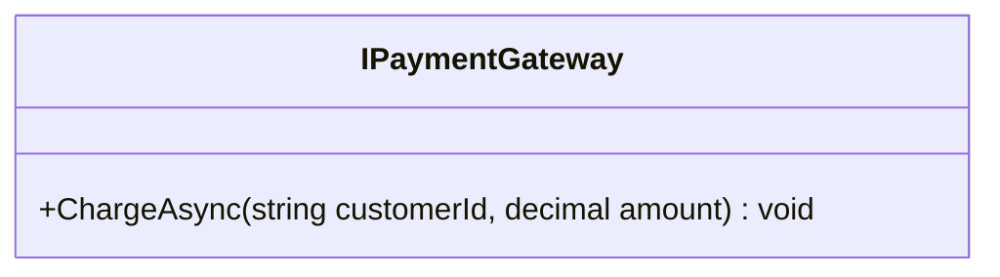

# Class: `IPaymentGateway`

> **Language**: `CSHARP` | **Source**: [`tests\sample_code\OrderService.cs`](../../tests\sample_code\OrderService.cs#L9-L18) | **Lines**: `9 - 18`

---

## 1. Class Architecture Diagram

---

## 2. Overview & Purpose

Defines an interface contract for paymentgateway capabilities.

### Why this class exists (Design Rationale)
Encapsulates specialized methods and state within a dedicated class unit adhering to single responsibility principles.

---

## 3. Key Responsibilities

- Provides operation `ChargeAsync`.

---

## 4. Method Signatures & Behavioral Analysis

| Method Name | Parameters | Return Type | Lines | Explanation |
| :--- | :--- | :--- | :--- | :--- |
| **`ChargeAsync`** | `customerId: string`, `amount: decimal` | `void` | L17-L17 | Executes `ChargeAsync` accepting 2 parameter(s) and returning `void`. |

---

## 6. Verifiable Code Citations

- Lines 9-18: Declares `IPaymentGateway` in `tests\sample_code\OrderService.cs`.
- Lines 17-17: Defines method `ChargeAsync`.

---

## 7. Known Architectural Boundaries & Limitations

- ⚠️ End-to-end integration requires inspecting classes calling or referenced by `IPaymentGateway`.
- ⚠️ Underlying data persistence and network latency characteristics depend on external runtime configuration.

---
*Auto-generated by GitHub Pipeline Code Documentation Engine.*
