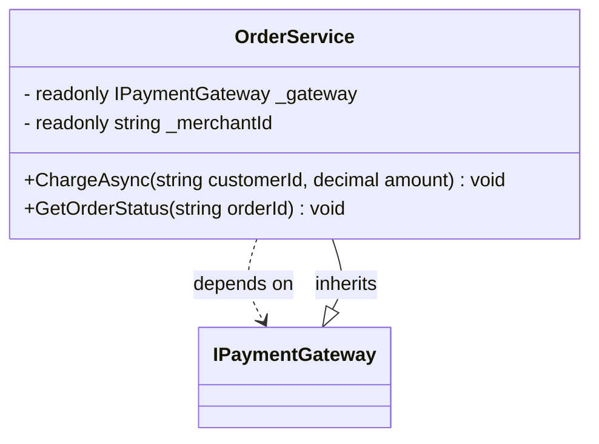

# Class: `OrderService`

> **Language**: `CSHARP` | **Source**: [`sample_project\OrderService.cs`](../../sample_project\OrderService.cs#L11-L32) | **Lines**: `11 - 32`

---

## 1. Class Architecture Diagram

---

## 2. Overview & Purpose

Encapsulates domain business logic and coordination for order workflows.

### Why this class exists (Design Rationale)
Implements inheritance/interface contract from `IPaymentGateway` ensuring substitutability. Employs Dependency Injection via constructor parameters to decouple implementations from caller code.

---

## 3. Key Responsibilities

- Provides operation `ChargeAsync`.
- Provides operation `GetOrderStatus`.

---

## 4. Method Signatures & Behavioral Analysis

| Method Name | Parameters | Return Type | Lines | Explanation |
| :--- | :--- | :--- | :--- | :--- |
| **`ChargeAsync`** | `customerId: string`, `amount: decimal` | `void` | L22-L26 | Executes `ChargeAsync` accepting 2 parameter(s) and returning `void`. |
| **`GetOrderStatus`** | `orderId: string` | `void` | L28-L31 | Executes `GetOrderStatus` accepting 1 parameter(s) and returning `void`. |

---

## 5. Injected Dependencies & Collaborators

- **`IPaymentGateway gateway`**: Injected dependency used for delegating operations.
- **`string merchantId`**: Injected dependency used for delegating operations.

---

## 6. Verifiable Code Citations

- Lines 11-32: Declares `OrderService` in `sample_project\OrderService.cs`.
- Lines 22-26: Defines method `ChargeAsync`.
- Lines 28-31: Defines method `GetOrderStatus`.

---

## 7. Known Architectural Boundaries & Limitations

- ⚠️ End-to-end integration requires inspecting classes calling or referenced by `OrderService`.
- ⚠️ Underlying data persistence and network latency characteristics depend on external runtime configuration.

---
*Auto-generated by GitHub Pipeline Code Documentation Engine.*
