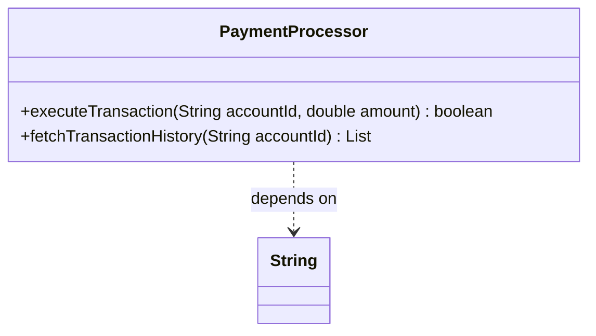

# Class: `PaymentProcessor`

> **Language**: `JAVA` | **Source**: [`sample_project\PaymentProcessor.java`](../../sample_project\PaymentProcessor.java#L12-L47) | **Lines**: `12 - 47`

---

## 1. Class Architecture Diagram

---

## 2. Overview & Purpose

Processes transactions and lifecycle tasks related to payment operations.

### Why this class exists (Design Rationale)
Employs Dependency Injection via constructor parameters to decouple implementations from caller code.

---

## 3. Key Responsibilities

- Provides operation `executeTransaction`.
- Provides operation `fetchTransactionHistory`.

---

## 4. Method Signatures & Behavioral Analysis

| Method Name | Parameters | Return Type | Lines | Explanation |
| :--- | :--- | :--- | :--- | :--- |
| **`executeTransaction`** | `accountId: String`, `amount: double` | `boolean` | L34-L36 | Executes `executeTransaction` accepting 2 parameter(s) and returning `boolean`. |
| **`fetchTransactionHistory`** | `accountId: String` | `List<String>` | L44-L46 | Executes `fetchTransactionHistory` accepting 1 parameter(s) and returning `List<String>`. |

---

## 5. Injected Dependencies & Collaborators

- **`String apiKey`**: Injected collaborator utilized for delegating specialized operations.
- **`int timeoutSeconds`**: Injected collaborator utilized for delegating specialized operations.

---

## 6. Verifiable Code Citations

- Lines 12-47: Declares `PaymentProcessor` in `sample_project\PaymentProcessor.java`.
- Lines 34-36: Defines method `executeTransaction`.
- Lines 44-46: Defines method `fetchTransactionHistory`.

---

## 7. Known Architectural Boundaries & Limitations

- ⚠️ End-to-end integration requires inspecting classes calling or referenced by `PaymentProcessor`.
- ⚠️ Underlying data persistence and network latency characteristics depend on external runtime configuration.

---
*Auto-generated by GitHub Pipeline Code Documentation Engine.*
