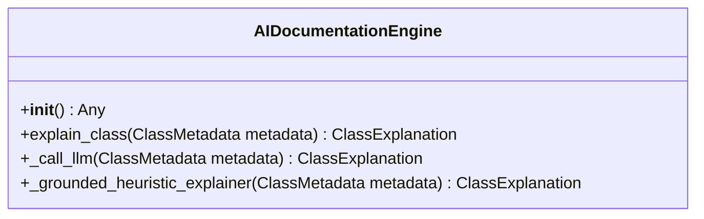

# Class: `AIDocumentationEngine`

> **Language**: `PYTHON` | **Source**: [`analyzer\ai_engine.py`](../../analyzer\ai_engine.py#L11-L147) | **Lines**: `11 - 147`

---

## 1. Class Architecture Diagram

---

## 2. Overview & Purpose

Provides core abstraction and behaviors for `AIDocumentationEngine`.

### Why this class exists (Design Rationale)
Encapsulates specialized methods and state within a dedicated class unit.

---

## 3. Key Responsibilities

- Initializes dependencies: None.
- Provides operation `explain_class`.
- Provides operation `_call_llm`.
- Provides operation `_grounded_heuristic_explainer`.

---

## 4. Method Signatures & Behavioral Analysis

| Method Name | Parameters | Return Type | Lines | Explanation |
| :--- | :--- | :--- | :--- | :--- |
| **`__init__`** | `self: Any` | `Any` | L12-L15 | Executes method logic. |
| **`explain_class`** | `self: Any`, `metadata: ClassMetadata` | `ClassExplanation` | L17-L29 | Explains class purpose and rationale.
        Uses LLM if API key is present; otherwise falls back to a deterministic heuristic engine. |
| **`_call_llm`** | `self: Any`, `metadata: ClassMetadata` | `ClassExplanation` | L31-L83 | Executes `_call_llm` accepting 2 parameter(s) and returning `ClassExplanation`. |
| **`_grounded_heuristic_explainer`** | `self: Any`, `metadata: ClassMetadata` | `ClassExplanation` | L85-L147 | Grounded deterministic fallback that extracts verifiable facts and observed patterns.
        Guarantees 100% offline availability with zero cost and zero hallucination. |

---

## 6. Verifiable Code Citations

- Lines 11-147: Declares `AIDocumentationEngine` in `analyzer\ai_engine.py`.
- Lines 12-15: Constructor initialization.
- Lines 17-29: Defines method `explain_class`.
- Lines 31-83: Defines method `_call_llm`.
- Lines 85-147: Defines method `_grounded_heuristic_explainer`.

---

## 7. Known Architectural Boundaries & Limitations

- ⚠️ End-to-end integration requires inspecting classes calling or referenced by `AIDocumentationEngine`.
- ⚠️ Underlying data persistence and network latency characteristics depend on external runtime configuration.

---
*Auto-generated by GitHub Pipeline Code Documentation Engine.*
