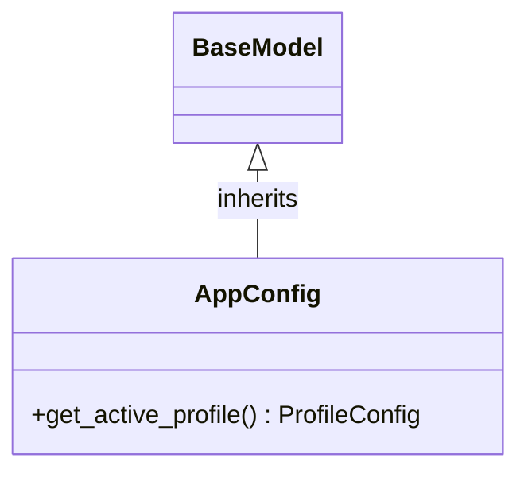

# Class: `AppConfig`

> **Language**: `PYTHON` | **Engine**: `GEMINI` | **Source**: [`analyzer/utils/config_loader.py`](../../analyzer/utils/config_loader.py#L62-L107) | **Lines**: `62 - 107`

---

## 1. Class Architecture Diagram

---

## 2. Overview & Purpose

Serves as the root configuration model (inheriting from Pydantic's BaseModel) that holds application settings such as deployment mode, profiles, logging, generator, and scanner configurations, while providing active profile resolution.

### Why this class exists (Design Rationale)
INFERRED: Designed to centralize application configuration parsing, offering structural type definitions via Pydantic and implementing a multi-tiered API key resolution mechanism (environment variable interpolation, standard LLM fallback env vars, and base64 default key decoding) to support flexible deployment environments.

---

## 3. Key Responsibilities

- Store root configuration settings including deployment_mode, profiles, logging, generator, and scanner configurations.
- Locate and return the active ProfileConfig based on the normalized deployment_mode value.
- Dynamically resolve API keys for the active profile using environment variable interpolation (${ENV_VAR}), standard environment fallbacks, or a decoded default action key.

---

## 4. Method Signatures & Behavioral Analysis

| Method Name | Parameters | Return Type | Lines | Explanation |
| :--- | :--- | :--- | :--- | :--- |
| **`get_active_profile`** | `self: Any` | `ProfileConfig` | L70-L107 | Normalizes deployment_mode to lower-case and matches it against profiles. If matched, resolves profile.api_key through variable interpolation (${ENV_VAR}), fallback environment variables (LLM_API_KEY, GEMINI_API_KEY, MISTRAL_API_KEY, ANTHROPIC_API_KEY), or base64 decoding of _DEFAULT_ACTION_KEY_B64, and returns the ProfileConfig. Returns a default ProfileConfig instance if the mode is not matched. |

---

## 6. Verifiable Code Citations

- Lines 62-68: Class declaration inheriting from BaseModel and defining attributes deployment_mode, profiles, logging, generator, and scanner.
- Lines 77-78: Normalizes deployment_mode using .lower().strip() and checks inclusion in self.profiles.
- Lines 81-84: Detects '${' and '}' syntax on profile.api_key and resolves the inner name via os.getenv.
- Lines 86-94: Performs fallback check against environment variables LLM_API_KEY, GEMINI_API_KEY, MISTRAL_API_KEY, and ANTHROPIC_API_KEY.
- Lines 96-102: Attempts base64 decoding of _DEFAULT_ACTION_KEY_B64 when api_key is still empty.
- Line 107: Returns a default ProfileConfig() when mode key is missing from self.profiles.

---

## 7. Known Architectural Boundaries & Limitations

- ⚠️ Modifies the profile.api_key attribute in-place on the object stored inside self.profiles when get_active_profile is invoked.
- ⚠️ Silently suppresses all exceptions (pass) during base64 decoding of _DEFAULT_ACTION_KEY_B64 without logging errors (Lines 100-102).
- ⚠️ Requires cross-file inspection to determine the definitions and default behavior of ProfileConfig, LoggingConfig, GeneratorConfig, ScannerConfig, and the external global _DEFAULT_ACTION_KEY_B64.

---
*Auto-generated by GitHub Pipeline Code Documentation Engine.*
