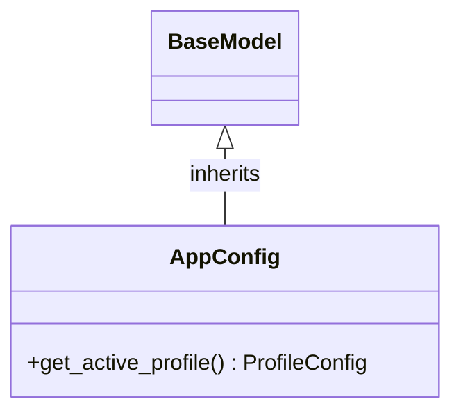

# Class: `AppConfig`

> **Language**: `PYTHON` | **Engine**: `GROUNDED_HEURISTIC` | **Source**: [`analyzer/utils/config_loader.py`](../../analyzer/utils/config_loader.py#L62-L107) | **Lines**: `62 - 107`

---

## 1. Overview & Architectural Purpose

Root configuration model representing config.json with deployment_mode.

### Design Rationale
Implements inheritance/interface contract from `BaseModel` ensuring substitutability and polymorphism.

---

## 2. Key Responsibilities & Capabilities

- Provides operation `get_active_profile`.

---

## 3. Method Signatures & Behavioral Analysis

| Method Name | Parameters | Return Type | Lines | Explanation |
| :--- | :--- | :--- | :--- | :--- |
| **`get_active_profile`** | `self: Any` | `ProfileConfig` | L70-L107 | Retrieves the profile directly designated by the `deployment_mode` in config.json.
        
        Returns:
            ProfileConfig instance for 'local' or 'production'. |

---

## 5. Verifiable Code Citations

- Lines 62-107: Declares `AppConfig` in `analyzer/utils/config_loader.py`.
- Lines 70-107: Defines method `get_active_profile`.

---

## 6. Known Architectural Boundaries & Limitations

- ⚠️ End-to-end integration requires inspecting classes calling or referenced by `AppConfig`.
- ⚠️ Underlying data persistence and network latency characteristics depend on external runtime configuration.

---

## 7. Structural Class Diagram (Mermaid)

---
*Auto-generated by Code Documentation Engine.*
