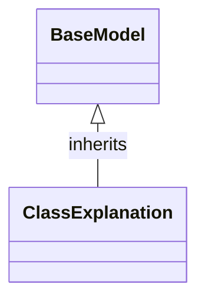

# Class: `ClassExplanation`

> **Language**: `PYTHON` | **Engine**: `GEMINI` | **Source**: [`analyzer/models/schemas.py`](../../analyzer/models/schemas.py#L48-L58) | **Lines**: `48 - 58`

---

## 1. Class Architecture Diagram

---

## 2. Overview & Purpose

Serves as a Pydantic data model representing a structured architectural explanation of a target class, populated by an AI engine or a heuristic fallback.

### Why this class exists (Design Rationale)
[INFERRED] Provides a standardized schema and type safety for exchange and serialization of class-level architectural analysis data across the system.

---

## 3. Key Responsibilities

- Define typed schema fields for architectural metadata (class name, engine used, purpose, design rationale).
- Store collections of operational duties, dependency roles, method explanations, line citations, and potential limitations with safe default factories.

---

## 4. Method Signatures & Behavioral Analysis

| Method Name | Parameters | Return Type | Lines | Explanation |
| :--- | :--- | :--- | :--- | :--- |

---

## 6. Verifiable Code Citations

- Line 48: Definition of ClassExplanation inheriting from BaseModel
- Lines 50-58: Field declarations for class_name, engine_used, purpose, design_rationale, responsibilities, dependencies_explained, key_methods_explained, evidence_citations, and potential_limitations

---

## 7. Known Architectural Boundaries & Limitations

- ⚠️ Contains no custom methods or validation logic beyond Pydantic default type enforcement.
- ⚠️ Cross-file inspection is required to observe how this schema is instantiated, processed, or persisted.

---
*Auto-generated by GitHub Pipeline Code Documentation Engine.*
