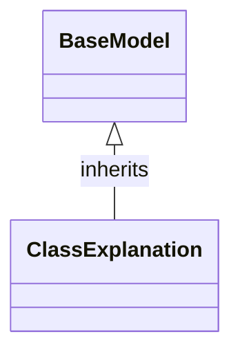

# Class: `ClassExplanation`

> **Language**: `PYTHON` | **Engine**: `GEMINI` | **Source**: [`analyzer/models/schemas.py`](../../analyzer/models/schemas.py#L48-L58) | **Lines**: `48 - 58`

---

## 1. Overview & Architectural Purpose

Acts as a Pydantic data model schema to structure and store architectural explanations generated by an AI engine or fallback heuristic for a target class.

### Design Rationale
INFERRED: Standardizes the data structure for class-level architectural documentation across the system, ensuring consistent reporting of class metadata, responsibilities, dependencies, method summaries, line citations, and limitations.

---

## 2. Key Responsibilities & Capabilities

- Define the schema for holding class analysis metrics, including class name, engine used, purpose, design rationale, responsibilities, dependencies, key methods, line citations, and limitations.
- Provide default field values and list/dict factories for optional analysis metadata fields.

---

## 3. Method Signatures & Behavioral Analysis

| Method Name | Parameters | Return Type | Lines | Explanation |
| :--- | :--- | :--- | :--- | :--- |

---

## 5. Verifiable Code Citations

- Line 48: Class definition inherits from Pydantic `BaseModel`
- Line 49: Docstring specifies 'Structured architectural explanation generated by the AI Engine or Fallback.'
- Line 50: `class_name` defined as a required string field
- Line 51: `engine_used` defined as a string field defaulting to 'GROUNDED_HEURISTIC'
- Lines 52-58: Fields defined for `purpose`, `design_rationale`, `responsibilities`, `dependencies_explained`, `key_methods_explained`, `evidence_citations`, and `potential_limitations`

---

## 6. Known Architectural Boundaries & Limitations

- ⚠️ Does not implement custom validation logic beyond default Pydantic field type enforcement.
- ⚠️ Cross-file inspection is required to observe where instances of this model are populated, validated, or serialized.

---

## 7. Structural Class Diagram (Mermaid)

---
*Auto-generated by Code Documentation Engine.*
