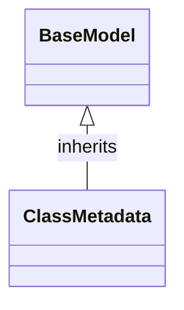

# Class: `ClassMetadata`

> **Language**: `PYTHON` | **Source**: [`analyzer\models.py`](../../analyzer\models.py#L20-L31) | **Lines**: `20 - 31`

---

## 1. Class Architecture Diagram

---

## 2. Overview & Purpose

Provides core abstraction and behaviors for `ClassMetadata`.

### Why this class exists (Design Rationale)
Implements inheritance/interface contract from `BaseModel` ensuring substitutability.

---

## 3. Key Responsibilities

---

## 4. Method Signatures & Behavioral Analysis

| Method Name | Parameters | Return Type | Lines | Explanation |
| :--- | :--- | :--- | :--- | :--- |

---

## 6. Verifiable Code Citations

- Lines 20-31: Declares `ClassMetadata` in `analyzer\models.py`.

---

## 7. Known Architectural Boundaries & Limitations

- ⚠️ End-to-end integration requires inspecting classes calling or referenced by `ClassMetadata`.
- ⚠️ Underlying data persistence and network latency characteristics depend on external runtime configuration.

---
*Auto-generated by GitHub Pipeline Code Documentation Engine.*
