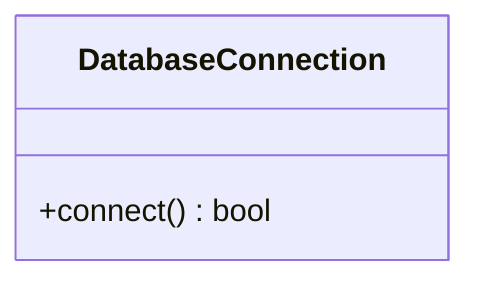

# Class: `DatabaseConnection`

> **Language**: `PYTHON` | **Source**: [`tests\sample_code\order_manager.py`](../../tests\sample_code\order_manager.py#L15-L28) | **Lines**: `15 - 28`

---

## 1. Class Architecture Diagram

---

## 2. Overview & Purpose

Manages low-level database pooling, transactions, and session lifecycle.

### Why this class exists (Design Rationale)
Encapsulates specialized methods and state within a dedicated class unit adhering to single responsibility principles.

---

## 3. Key Responsibilities

- Provides operation `connect`.

---

## 4. Method Signatures & Behavioral Analysis

| Method Name | Parameters | Return Type | Lines | Explanation |
| :--- | :--- | :--- | :--- | :--- |
| **`connect`** | `self: Any` | `bool` | L20-L28 | Establishes an active pooled database connection.
        
        Returns:
            bool: True if connection handshake succeeded, False otherwise. |

---

## 6. Verifiable Code Citations

- Lines 15-28: Declares `DatabaseConnection` in `tests\sample_code\order_manager.py`.
- Lines 20-28: Defines method `connect`.

---

## 7. Known Architectural Boundaries & Limitations

- ⚠️ End-to-end integration requires inspecting classes calling or referenced by `DatabaseConnection`.
- ⚠️ Underlying data persistence and network latency characteristics depend on external runtime configuration.

---
*Auto-generated by GitHub Pipeline Code Documentation Engine.*
