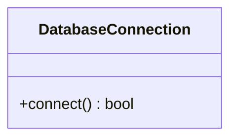

# Class: `DatabaseConnection`

> **Language**: `PYTHON` | **Source**: [`sample_project\order_manager.py`](../../sample_project\order_manager.py#L3-L6) | **Lines**: `3 - 6`

---

## 1. Class Architecture Diagram

---

## 2. Overview & Purpose

Handles low-level database pooling.

### Why this class exists (Design Rationale)
Encapsulates specialized methods and state within a dedicated class unit.

---

## 3. Key Responsibilities

- Provides operation `connect`.

---

## 4. Method Signatures & Behavioral Analysis

| Method Name | Parameters | Return Type | Lines | Explanation |
| :--- | :--- | :--- | :--- | :--- |
| **`connect`** | `self: Any` | `bool` | L5-L6 | Executes `connect` accepting 1 parameter(s) and returning `bool`. |

---

## 6. Verifiable Code Citations

- Lines 3-6: Declares `DatabaseConnection` in `sample_project\order_manager.py`.
- Lines 5-6: Defines method `connect`.

---

## 7. Known Architectural Boundaries & Limitations

- ⚠️ End-to-end integration requires inspecting classes calling or referenced by `DatabaseConnection`.
- ⚠️ Underlying data persistence and network latency characteristics depend on external runtime configuration.

---
*Auto-generated by GitHub Pipeline Code Documentation Engine.*
