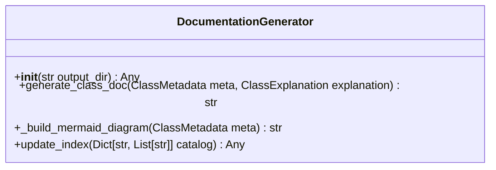

# Class: `DocumentationGenerator`

> **Language**: `PYTHON` | **Source**: [`analyzer\doc_generator.py`](../../analyzer\doc_generator.py#L5-L126) | **Lines**: `5 - 126`

---

## 1. Class Architecture Diagram

---

## 2. Overview & Purpose

Provides core abstraction and behaviors for `DocumentationGenerator`.

### Why this class exists (Design Rationale)
Employs Dependency Injection via constructor parameters to decouple implementations from caller code.

---

## 3. Key Responsibilities

- Initializes dependencies: output_dir.
- Provides operation `generate_class_doc`.
- Provides operation `_build_mermaid_diagram`.
- Provides operation `update_index`.

---

## 4. Method Signatures & Behavioral Analysis

| Method Name | Parameters | Return Type | Lines | Explanation |
| :--- | :--- | :--- | :--- | :--- |
| **`__init__`** | `self: Any`, `output_dir: str` | `Any` | L6-L9 | Executes method logic. |
| **`generate_class_doc`** | `self: Any`, `meta: ClassMetadata`, `explanation: ClassExplanation` | `str` | L11-L73 | Executes `generate_class_doc` accepting 3 parameter(s) and returning `str`. |
| **`_build_mermaid_diagram`** | `self: Any`, `meta: ClassMetadata` | `str` | L75-L100 | Executes `_build_mermaid_diagram` accepting 2 parameter(s) and returning `str`. |
| **`update_index`** | `self: Any`, `catalog: Dict[str, List[str]]` | `Any` | L102-L126 | Executes `update_index` accepting 2 parameter(s) and returning `Any`. |

---

## 5. Injected Dependencies & Collaborators

- **`output_dir: str`**: Injected dependency used for delegating operations.

---

## 6. Verifiable Code Citations

- Lines 5-126: Declares `DocumentationGenerator` in `analyzer\doc_generator.py`.
- Lines 6-9: Constructor initialization.
- Lines 11-73: Defines method `generate_class_doc`.
- Lines 75-100: Defines method `_build_mermaid_diagram`.
- Lines 102-126: Defines method `update_index`.

---

## 7. Known Architectural Boundaries & Limitations

- ⚠️ End-to-end integration requires inspecting classes calling or referenced by `DocumentationGenerator`.
- ⚠️ Underlying data persistence and network latency characteristics depend on external runtime configuration.

---
*Auto-generated by GitHub Pipeline Code Documentation Engine.*
