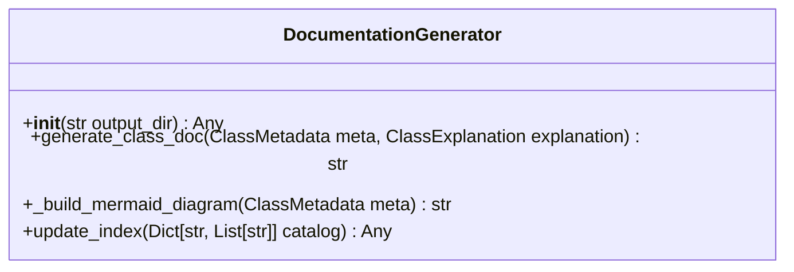

# Class: `DocumentationGenerator`

> **Language**: `PYTHON` | **Engine**: `GEMINI` | **Source**: [`analyzer/doc_generator.py`](../../analyzer/doc_generator.py#L19-L166) | **Lines**: `19 - 166`

---

## 1. Overview & Architectural Purpose

Renders structured AST metadata and architectural explanations into Markdown files featuring formatted tables and Mermaid class diagrams, while maintaining a master documentation catalog index.

### Design Rationale
Separates visual documentation rendering logic from AST parsing and AI heuristic analysis. Inferred rationale includes providing standardized architectural documentation formats and visual diagrams across multiple programming languages.

---

## 2. Key Responsibilities & Capabilities

- Creates language-specific subdirectories and writes structured Markdown files for individual classes (Lines 33-100).
- Generates visual Mermaid classDiagram string representations depicting fields, methods, inheritance, and dependency relationships (Lines 102-132).
- Constructs and updates a central README.md file cataloging generated class documentation categorized by language (Lines 134-165).

---

## 3. Method Signatures & Behavioral Analysis

| Method Name | Parameters | Return Type | Lines | Explanation |
| :--- | :--- | :--- | :--- | :--- |
| **`__init__`** | `self: Any`, `output_dir: str` | `Any` | L24-L33 | Initializes output path variables and creates the 'architecture' target subdirectory on disk if it does not exist (Lines 25-31). |
| **`generate_class_doc`** | `self: Any`, `meta: ClassMetadata`, `explanation: ClassExplanation` | `str` | L35-L102 | Formats ClassMetadata and ClassExplanation attributes into a Markdown file, builds its Mermaid diagram, writes it to disk under a language-specific folder, and returns the file path (Lines 33-100). |
| **`_build_mermaid_diagram`** | `self: Any`, `meta: ClassMetadata` | `str` | L104-L134 | Parses fields (up to 5), method signatures, inherited base classes, and non-primitive injected dependencies from ClassMetadata to produce a Mermaid classDiagram definition string (Lines 102-132). |
| **`update_index`** | `self: Any`, `catalog: Dict[str, List[str]]` | `Any` | L136-L166 | Creates or overwrites the root README.md index with sorted tables linking to generated class documentation grouped by programming language (Lines 134-165). |

---

## 4. Injected Dependencies & Collaborators

- **`output_dir`**: Base filesystem directory string where documentation folders and the root README index are generated (Default: 'docs').

---

## 5. Verifiable Code Citations

- Lines 30-31: Uses os.makedirs to ensure the 'architecture' output directory exists.
- Lines 38-40: Constructs language-specific target paths using meta.language.capitalize() and meta.name.
- Line 110: Slices meta.fields[:5] when generating field definitions in Mermaid syntax.
- Lines 125-129: Filters out primitive types ('int', 'str', 'string', 'bool', 'double', 'float', 'Any') when building dependency arrows.
- Lines 97-98 & 163-164: Performs direct UTF-8 file write operations using open().

---

## 6. Known Architectural Boundaries & Limitations

- ⚠️ Diagram field generation hard-limits displayed fields to 5 without adding an indicator for truncated fields (Line 110).
- ⚠️ No exception handling around file I/O operations (Lines 97-98, 163-164); permission errors or invalid paths will fail unhandled.
- ⚠️ Cross-file inspection required to verify the schema and attribute types of ClassMetadata and ClassExplanation objects.

---

## 7. Structural Class Diagram (Mermaid)

---
*Auto-generated by Code Documentation Engine.*
