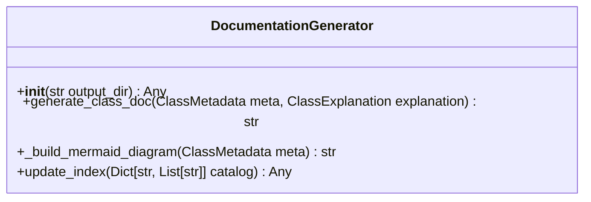

# Class: `DocumentationGenerator`

> **Language**: `PYTHON` | **Engine**: `GEMINI` | **Source**: [`analyzer/doc_generator.py`](../../analyzer/doc_generator.py#L19-L166) | **Lines**: `19 - 166`

---

## 1. Overview & Architectural Purpose

Renders AST metadata and structural explanations into Markdown documentation files featuring embedded Mermaid diagrams and updates a master documentation catalog index.

### Design Rationale
INFERRED: Encapsulates documentation template rendering and file formatting logic away from metadata extraction engines, providing a unified output interface for architectural documentation generation.

---

## 2. Key Responsibilities & Capabilities

- Initializes output directories on the file system for architecture documentation.
- Generates detailed Markdown documentation files per class including metadata tables, citations, limitations, and Mermaid diagrams.
- Constructs Mermaid class diagrams reflecting fields, methods, inheritance, and dependency relationships.
- Updates a root README.md file with an alphabetized index catalog of all generated class documentation relative to the output directory.

---

## 3. Method Signatures & Behavioral Analysis

| Method Name | Parameters | Return Type | Lines | Explanation |
| :--- | :--- | :--- | :--- | :--- |
| **`__init__`** | `self: Any`, `output_dir: str` | `Any` | L24-L33 | Sets output directory paths and ensures the 'architecture' target directory exists on disk. |
| **`generate_class_doc`** | `self: Any`, `meta: ClassMetadata`, `explanation: ClassExplanation` | `str` | L35-L102 | Assembles structured Markdown content combining metadata and explanation data, writes the file to a language-specific subdirectory, and returns the file path. |
| **`_build_mermaid_diagram`** | `self: Any`, `meta: ClassMetadata` | `str` | L104-L134 | Builds and returns a Mermaid `classDiagram` formatted string representing class fields, methods, inheritance, and non-primitive dependencies. |
| **`update_index`** | `self: Any`, `catalog: Dict[str, List[str]]` | `Any` | L136-L166 | Generates and writes a master README.md index catalog containing relative Markdown links to all generated documentation, categorized by language. |

---

## 4. Injected Dependencies & Collaborators

- **`output_dir: str`**: Directory path string specifying where generated architecture documentation files and the README index should be written.

---

## 5. Verifiable Code Citations

- Lines 30-32: Initializes directory properties (`output_dir`, `arch_dir`) and invokes `os.makedirs`.
- Lines 45-47: Builds subdirectories based on `meta.language.capitalize()` and target Markdown file paths.
- Lines 50-94: Invokes `_build_mermaid_diagram`, formats Markdown strings, and writes the output file with `utf-8` encoding.
- Lines 103-130: Formats string lines representing Mermaid `classDiagram` elements including fields, methods, inheritance (`<|--`), and dependencies (`..>`).
- Lines 139-164: Formats `README.md` catalog using `os.path.relpath` and writes it to disk.

---

## 6. Known Architectural Boundaries & Limitations

- ⚠️ Truncates class fields to a maximum of 5 items when building Mermaid diagrams (Line 108).
- ⚠️ Dependency type parsing in `_build_mermaid_diagram` uses string splitting (Line 124), which may fail or improperly parse complex or generic nested types.
- ⚠️ Lacks explicit exception handling around file system writes (`open()`, `os.makedirs()`) on lines 32, 46, 93, and 163.
- ⚠️ Cross-file inspection is required to determine the structural implementation of `ClassMetadata` and `ClassExplanation` types.

---

## 7. Structural Class Diagram (Mermaid)

---
*Auto-generated by Code Documentation Engine.*
