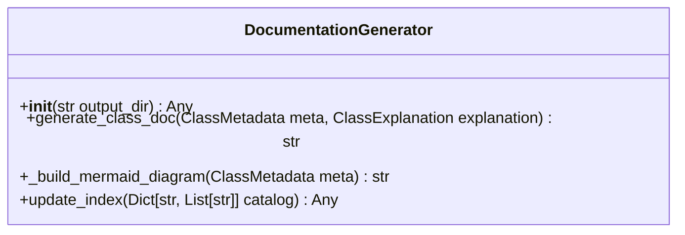

# Class: `DocumentationGenerator`

> **Language**: `PYTHON` | **Engine**: `GROUNDED_HEURISTIC` | **Source**: [`analyzer\doc_generator.py`](../../analyzer\doc_generator.py#L19-L174) | **Lines**: `19 - 174`

---

## 1. Class Architecture Diagram

---

## 2. Overview & Purpose

Renders structured metadata into publication-ready Markdown documents with Mermaid diagrams.

### Why this class exists (Design Rationale)
Employs Dependency Injection via constructor parameters to decouple implementations from caller code.

---

## 3. Key Responsibilities

- Initializes instance dependencies: output_dir.
- Provides operation `generate_class_doc`.
- Provides operation `_build_mermaid_diagram`.
- Provides operation `update_index`.

---

## 4. Method Signatures & Behavioral Analysis

| Method Name | Parameters | Return Type | Lines | Explanation |
| :--- | :--- | :--- | :--- | :--- |
| **`__init__`** | `self: Any`, `output_dir: str` | `Any` | L24-L33 | Initializes the documentation builder.
        
        Args:
            output_dir: Base directory where docs will be written (default: 'docs'). |
| **`generate_class_doc`** | `self: Any`, `meta: ClassMetadata`, `explanation: ClassExplanation` | `str` | L35-L110 | Writes a Markdown documentation file for an individual class.
        
        Args:
            meta: Raw parsed AST metadata.
            explanation: Architectural explanation from AI or Heuristic engine.
            
        Returns:
            Absolute or relative file path to the generated Markdown file. |
| **`_build_mermaid_diagram`** | `self: Any`, `meta: ClassMetadata` | `str` | L112-L142 | Constructs a Mermaid classDiagram string depicting methods, fields, and inheritance. |
| **`update_index`** | `self: Any`, `catalog: Dict[str, List[str]]` | `Any` | L144-L174 | Updates the root docs/README.md file with an alphabetized index of all generated documentation.
        
        Args:
            catalog: Dictionary mapping Language name to list of generated Markdown file paths. |

---

## 5. Injected Dependencies & Collaborators

- **`output_dir: str`**: Injected collaborator utilized for delegating specialized operations.

---

## 6. Verifiable Code Citations

- Lines 19-174: Declares `DocumentationGenerator` in `analyzer\doc_generator.py`.
- Lines 24-33: Constructor initialization.
- Lines 35-110: Defines method `generate_class_doc`.
- Lines 112-142: Defines method `_build_mermaid_diagram`.
- Lines 144-174: Defines method `update_index`.

---

## 7. Known Architectural Boundaries & Limitations

- ⚠️ End-to-end integration requires inspecting classes calling or referenced by `DocumentationGenerator`.
- ⚠️ Underlying data persistence and network latency characteristics depend on external runtime configuration.

---
*Auto-generated by GitHub Pipeline Code Documentation Engine.*
