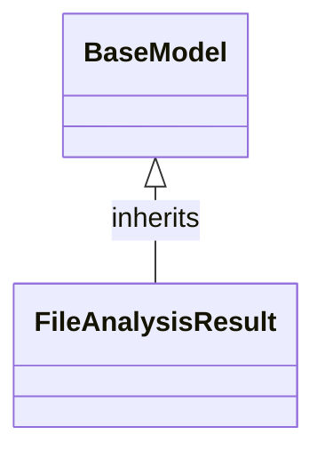

# Class: `FileAnalysisResult`

> **Language**: `PYTHON` | **Engine**: `GEMINI` | **Source**: [`analyzer/models/schemas.py`](../../analyzer/models/schemas.py#L61-L65) | **Lines**: `61 - 65`

---

## 1. Class Architecture Diagram

---

## 2. Overview & Purpose

Serves as a data schema encapsulating the analysis outcome for a single source file, including its file path, programming language, and parsed class metadata.

### Why this class exists (Design Rationale)
OBSERVED: Inherits from Pydantic's BaseModel to enforce type annotations and structure analysis output. INFERRED: Acts as a Data Transfer Object (DTO) to standardise analysis results passed between parsing engines and downstream processing or reporting components.

---

## 3. Key Responsibilities

- Hold metadata identifying the source file (path and programming language).
- Store a list of parsed class structures (`ClassMetadata`) extracted from the file.

---

## 4. Method Signatures & Behavioral Analysis

| Method Name | Parameters | Return Type | Lines | Explanation |
| :--- | :--- | :--- | :--- | :--- |

---

## 6. Verifiable Code Citations

- Line 61: Defines `FileAnalysisResult` class inheriting from `BaseModel`.
- Line 62: Docstring explicitly states encapsulation of all classes discovered within a single source file.
- Line 63: Defines required string field `file_path` using `Field(...)`.
- Line 64: Defines required string field `language` using `Field(...)`.
- Line 65: Defines `classes` field as `List[ClassMetadata]` with `default_factory=list`.

---

## 7. Known Architectural Boundaries & Limitations

- ⚠️ Does not perform file system checks to verify if `file_path` exists or is valid (treated purely as a string).
- ⚠️ Requires cross-file inspection of `ClassMetadata` to understand the internal structure of parsed classes.
- ⚠️ No observed custom validation rules beyond standard Pydantic type checks.

---
*Auto-generated by GitHub Pipeline Code Documentation Engine.*
