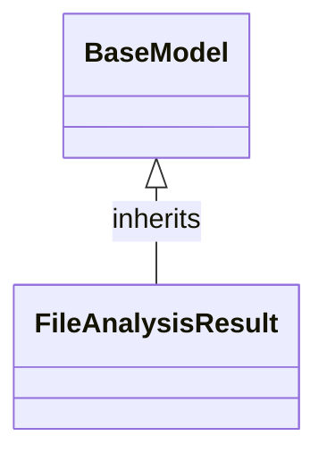

# Class: `FileAnalysisResult`

> **Language**: `PYTHON` | **Engine**: `GEMINI` | **Source**: [`analyzer/models/schemas.py`](../../analyzer/models/schemas.py#L61-L65) | **Lines**: `61 - 65`

---

## 1. Overview & Architectural Purpose

Encapsulates the structured output of analyzing a single source file, containing its file path, detected programming language, and a list of parsed class metadata.

### Design Rationale
OBSERVED: Standardizes the data structure for file-level analysis outputs by leveraging Pydantic's BaseModel.
INFERRED: Provides type safety, automatic validation, and serialization for downstream consumption when aggregating analysis results across multiple files.

---

## 2. Key Responsibilities & Capabilities

- Represent the file path and detected programming language of an analyzed file.
- Store a list of ClassMetadata instances representing all parsed classes discovered within the target file.

---

## 3. Method Signatures & Behavioral Analysis

| Method Name | Parameters | Return Type | Lines | Explanation |
| :--- | :--- | :--- | :--- | :--- |

---

## 5. Verifiable Code Citations

- Line 61: Inherits from BaseModel and includes docstring defining purpose.
- Line 63: Defines 'file_path' as a required string field using Field(...).
- Line 64: Defines 'language' as a required string field using Field(...).
- Line 65: Defines 'classes' as a List[ClassMetadata] defaulting to an empty list via default_factory=list.

---

## 6. Known Architectural Boundaries & Limitations

- ⚠️ Does not perform file reading, parsing, or language detection itself; relies on external callers to populate data.
- ⚠️ Requires cross-file inspection of ClassMetadata to verify the structure and validation rules of the class elements.
- ⚠️ No explicit field validation rules (e.g., verifying file existence or specific language enumerations) are observable in this schema.

---

## 7. Structural Class Diagram (Mermaid)

---
*Auto-generated by Code Documentation Engine.*
