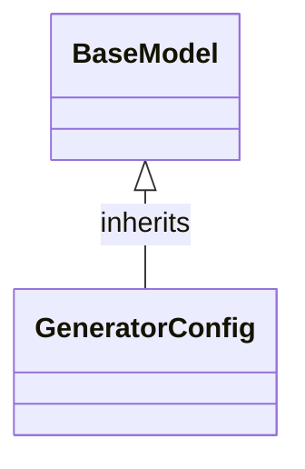

# Class: `GeneratorConfig`

> **Language**: `PYTHON` | **Engine**: `GEMINI` | **Source**: [`analyzer/utils/config_loader.py`](../../analyzer/utils/config_loader.py#L31-L35) | **Lines**: `31 - 35`

---

## 1. Class Architecture Diagram

---

## 2. Overview & Purpose

Defines configuration settings for documentation output formatting, such as the output directory and options for Mermaid class diagrams.

### Why this class exists (Design Rationale)
OBSERVED: Encapsulates documentation generator settings in a data structure inheriting from BaseModel, assigning explicit defaults and field descriptions using Field. INFERRED: Provides a centralized, strongly-typed schema to ensure consistent formatting options across the documentation generation pipeline.

---

## 3. Key Responsibilities

- Hold the output directory path for generated Markdown documentation.
- Specify whether Mermaid class diagrams should be embedded in the documentation.
- Define the maximum number of fields to display inside Mermaid class boxes.

---

## 4. Method Signatures & Behavioral Analysis

| Method Name | Parameters | Return Type | Lines | Explanation |
| :--- | :--- | :--- | :--- | :--- |

---

## 6. Verifiable Code Citations

- Line 31: GeneratorConfig defined inheriting from BaseModel
- Line 32: Docstring specifies 'Configuration for documentation output formatting.'
- Line 33: output_dir defined with default value 'docs' via Field
- Line 34: include_mermaid_diagrams defined with default value True via Field
- Line 35: max_fields_in_diagram defined with default value 5 via Field

---

## 7. Known Architectural Boundaries & Limitations

- ⚠️ Does not observe explicit path validation or numerical constraints (e.g., verifying max_fields_in_diagram is non-negative) within the class body; cross-file inspection is required to determine if validation occurs elsewhere.
- ⚠️ Contains no loading or serialization methods; cross-file inspection is required to see how this configuration is instantiated or populated from files/environment variables.

---
*Auto-generated by GitHub Pipeline Code Documentation Engine.*
