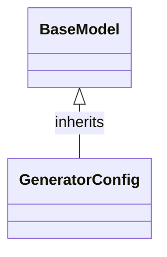

# Class: `GeneratorConfig`

> **Language**: `PYTHON` | **Engine**: `GEMINI` | **Source**: [`analyzer/utils/config_loader.py`](../../analyzer/utils/config_loader.py#L31-L35) | **Lines**: `31 - 35`

---

## 1. Class Architecture Diagram

---

## 2. Overview & Purpose

Holds data attributes for documentation output formatting, including the output directory path, whether to include Mermaid diagrams, and diagram field limits.

### Why this class exists (Design Rationale)
[INFERRED] Encapsulates generator-related configuration parameters into a strongly-typed model (BaseModel) to provide sensible default values and structured access.

---

## 3. Key Responsibilities

- Store the target directory path for generated Markdown documentation.
- Store a boolean flag indicating whether Mermaid class diagrams should be embedded.
- Store an integer specifying the maximum number of fields to display in diagram boxes.

---

## 4. Method Signatures & Behavioral Analysis

| Method Name | Parameters | Return Type | Lines | Explanation |
| :--- | :--- | :--- | :--- | :--- |

---

## 6. Verifiable Code Citations

- Line 31: Class definition inheriting from BaseModel.
- Line 32: Class docstring stating 'Configuration for documentation output formatting.'
- Line 33: Defines output_dir with default 'docs'.
- Line 34: Defines include_mermaid_diagrams with default True.
- Line 35: Defines max_fields_in_diagram with default 5.

---

## 7. Known Architectural Boundaries & Limitations

- ⚠️ No custom field validators or error handling logic are explicitly defined in this class.
- ⚠️ Cross-file inspection is required to observe where and how this configuration model is instantiated, populated, or validated at runtime.

---
*Auto-generated by GitHub Pipeline Code Documentation Engine.*
