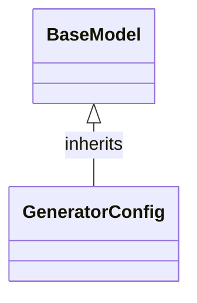

# Class: `GeneratorConfig`

> **Language**: `PYTHON` | **Engine**: `GEMINI` | **Source**: [`analyzer/utils/config_loader.py`](../../analyzer/utils/config_loader.py#L31-L35) | **Lines**: `31 - 35`

---

## 1. Overview & Architectural Purpose

Holds configuration settings for documentation output formatting, including output directory paths and Mermaid class diagram display parameters.

### Design Rationale
OBSERVED: Encapsulates documentation generation settings into a single structured model using standard schema field definitions. INFERRED: Uses Pydantic's `BaseModel` to provide type hints, default values, and description metadata for configuration management across the codebase.

---

## 2. Key Responsibilities & Capabilities

- Define schema, defaults, and descriptions for documentation output directory (`output_dir`).
- Define boolean flags for enabling or disabling Mermaid class diagrams (`include_mermaid_diagrams`).
- Define limits for the maximum number of fields shown in diagram boxes (`max_fields_in_diagram`).

---

## 3. Method Signatures & Behavioral Analysis

| Method Name | Parameters | Return Type | Lines | Explanation |
| :--- | :--- | :--- | :--- | :--- |

---

## 5. Verifiable Code Citations

- Line 31: Class definition `class GeneratorConfig(BaseModel):` inherits from `BaseModel`.
- Line 32: Docstring `"""Configuration for documentation output formatting."""`.
- Line 33: `output_dir: str = Field("docs", description="...")` specifies default directory.
- Line 34: `include_mermaid_diagrams: bool = Field(True, description="...")` specifies diagram toggle default.
- Line 35: `max_fields_in_diagram: int = Field(5, description="...")` specifies field display threshold.

---

## 6. Known Architectural Boundaries & Limitations

- ⚠️ No explicit path validation or directory creation logic exists in this class; verifying if `output_dir` is valid requires cross-file inspection of consumer modules.
- ⚠️ No custom methods defined for dynamic configuration re-loading or serialization.

---

## 7. Structural Class Diagram (Mermaid)

---
*Auto-generated by Code Documentation Engine.*
