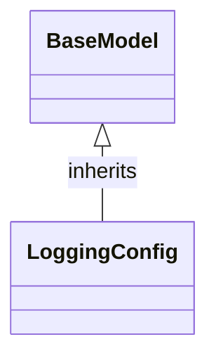

# Class: `LoggingConfig`

> **Language**: `PYTHON` | **Engine**: `GEMINI` | **Source**: [`analyzer/utils/config_loader.py`](../../analyzer/utils/config_loader.py#L56-L59) | **Lines**: `56 - 59`

---

## 1. Overview & Architectural Purpose

Defines a structured configuration schema for log management and retention settings with default values.

### Design Rationale
INFERRED: Encapsulates logging parameters into a typed Pydantic model to separate configuration schema from execution logic and ensure consistent default parameters across the application.

---

## 2. Key Responsibilities & Capabilities

- Stores default retention time limit for log files in hours (max_age_hours)
- Stores default maximum combined size for log directories in megabytes (max_size_mb)

---

## 3. Method Signatures & Behavioral Analysis

| Method Name | Parameters | Return Type | Lines | Explanation |
| :--- | :--- | :--- | :--- | :--- |

---

## 5. Verifiable Code Citations

- Line 56: Class definition inheriting from BaseModel
- Line 57: Class docstring 'Configuration for log management and retention.'
- Line 58: Definition of max_age_hours field with default float value 1.0
- Line 59: Definition of max_size_mb field with default float value 10.0

---

## 6. Known Architectural Boundaries & Limitations

- ⚠️ No custom methods or validation logic are implemented in this class.
- ⚠️ Actual log rotation, cleanup, or file size enforcement requires cross-file inspection of consumers using this configuration model.

---

## 7. Structural Class Diagram (Mermaid)

---
*Auto-generated by Code Documentation Engine.*
