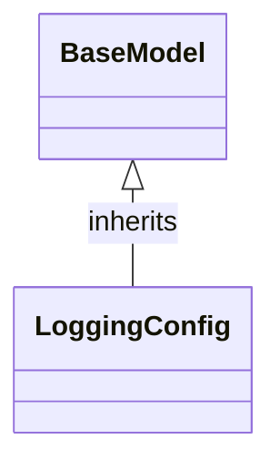

# Class: `LoggingConfig`

> **Language**: `PYTHON` | **Engine**: `GEMINI` | **Source**: [`analyzer/utils/config_loader.py`](../../analyzer/utils/config_loader.py#L56-L59) | **Lines**: `56 - 59`

---

## 1. Class Architecture Diagram

---

## 2. Overview & Purpose

Provides a structured Pydantic model for holding log management and retention configuration parameters.

### Why this class exists (Design Rationale)
INFERRED: Uses a centralized Pydantic data model to enforce type safety, provide sensible defaults, and separate configuration schemas from business logic across the application.

---

## 3. Key Responsibilities

- Define schema and default value (1.0 hour) for log file age retention limits via max_age_hours.
- Define schema and default value (10.0 MB) for log directory size limits via max_size_mb.

---

## 4. Method Signatures & Behavioral Analysis

| Method Name | Parameters | Return Type | Lines | Explanation |
| :--- | :--- | :--- | :--- | :--- |

---

## 6. Verifiable Code Citations

- Line 56: Defines LoggingConfig inheriting from BaseModel with docstring 'Configuration for log management and retention.'
- Line 58: Declares max_age_hours as a float defaulting to 1.0 with a description field.
- Line 59: Declares max_size_mb as a float defaulting to 10.0 with a description field.

---

## 7. Known Architectural Boundaries & Limitations

- ⚠️ No explicit bounds checking or validation (e.g., preventing negative values for max_age_hours or max_size_mb) is present in the class definition.
- ⚠️ Log purging and retention execution are not implemented here; cross-file inspection is required to determine how these configuration fields are consumed.

---
*Auto-generated by GitHub Pipeline Code Documentation Engine.*
