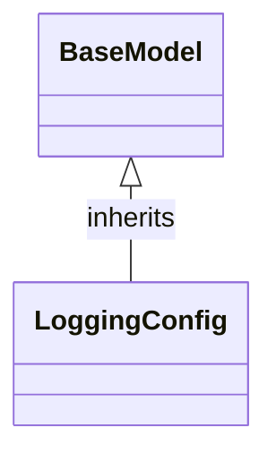

# Class: `LoggingConfig`

> **Language**: `PYTHON` | **Engine**: `GEMINI` | **Source**: [`analyzer/utils/config_loader.py`](../../analyzer/utils/config_loader.py#L56-L59) | **Lines**: `56 - 59`

---

## 1. Class Architecture Diagram

---

## 2. Overview & Purpose

Provides a data model for log retention parameters, specifically managing maximum age and maximum size thresholds.

### Why this class exists (Design Rationale)
INFERRED: Inherits from Pydantic's BaseModel to enforce type safety, set default configuration values, and decouple log management configuration parameters from log execution/cleanup logic.

---

## 3. Key Responsibilities

- Define and hold the maximum log file retention age in hours (max_age_hours).
- Define and hold the maximum combined log directory size in megabytes (max_size_mb).

---

## 4. Method Signatures & Behavioral Analysis

| Method Name | Parameters | Return Type | Lines | Explanation |
| :--- | :--- | :--- | :--- | :--- |

---

## 6. Verifiable Code Citations

- Line 56: Class definition inheriting from BaseModel
- Line 57: Docstring defining 'Configuration for log management and retention.'
- Line 58: Definition of max_age_hours float field with default 1.0
- Line 59: Definition of max_size_mb float field with default 10.0

---

## 7. Known Architectural Boundaries & Limitations

- ⚠️ Does not contain operational log cleanup, file scanning, or deletion logic; cross-file inspection is required to see where these parameters are consumed.
- ⚠️ Does not define explicit Pydantic validators (e.g., ensuring values are positive non-zero numbers) beyond default float type validation.

---
*Auto-generated by GitHub Pipeline Code Documentation Engine.*
