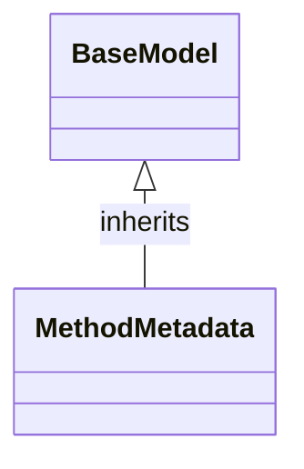

# Class: `MethodMetadata`

> **Language**: `PYTHON` | **Source**: [`analyzer\models.py`](../../analyzer\models.py#L30-L53) | **Lines**: `30 - 53`

---

## 1. Class Architecture Diagram

---

## 2. Overview & Purpose

Represents a method, function, or constructor within a class declaration.

### Why this class exists (Design Rationale)
Implements inheritance/interface contract from `BaseModel` ensuring substitutability and polymorphism.

---

## 3. Key Responsibilities

---

## 4. Method Signatures & Behavioral Analysis

| Method Name | Parameters | Return Type | Lines | Explanation |
| :--- | :--- | :--- | :--- | :--- |

---

## 6. Verifiable Code Citations

- Lines 30-53: Declares `MethodMetadata` in `analyzer\models.py`.

---

## 7. Known Architectural Boundaries & Limitations

- ⚠️ End-to-end integration requires inspecting classes calling or referenced by `MethodMetadata`.
- ⚠️ Underlying data persistence and network latency characteristics depend on external runtime configuration.

---
*Auto-generated by GitHub Pipeline Code Documentation Engine.*
