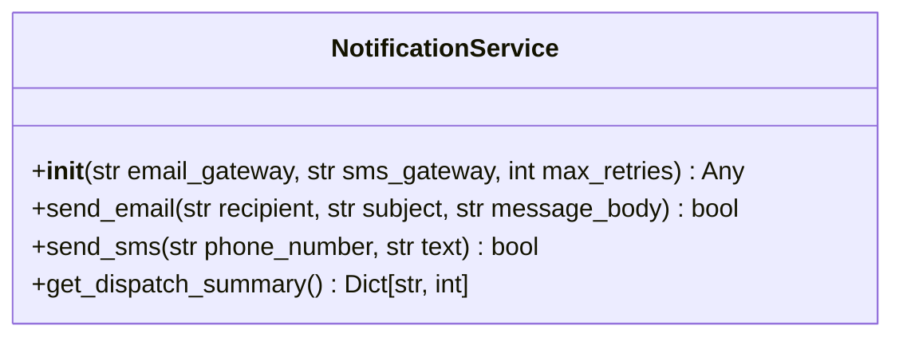

# Class: `NotificationService`

> **Language**: `PYTHON` | **Engine**: `GROUNDED_HEURISTIC` | **Source**: [`src/notification_service.py`](../../src/notification_service.py#L11-L56) | **Lines**: `11 - 56`

---

## 1. Class Architecture Diagram

---

## 2. Overview & Purpose

Coordinates multi-channel delivery of transactional alerts, emails, and SMS notices.

### Why this class exists (Design Rationale)
Employs Dependency Injection via constructor parameters to decouple implementations from caller code.

---

## 3. Key Responsibilities

- Initializes instance dependencies: email_gateway, sms_gateway, max_retries.
- Provides operation `send_email`.
- Provides operation `send_sms`.
- Provides operation `get_dispatch_summary`.

---

## 4. Method Signatures & Behavioral Analysis

| Method Name | Parameters | Return Type | Lines | Explanation |
| :--- | :--- | :--- | :--- | :--- |
| **`__init__`** | `self: Any`, `email_gateway: str`, `sms_gateway: str`, `max_retries: int` | `Any` | L16-L23 | Initializes the notification service with required third-party dispatch providers. |
| **`send_email`** | `self: Any`, `recipient: str`, `subject: str`, `message_body: str` | `bool` | L25-L34 | Transmits an email alert via the configured email delivery gateway. |
| **`send_sms`** | `self: Any`, `phone_number: str`, `text: str` | `bool` | L36-L45 | Dispatches a short message service alert to the destination mobile subscriber. |
| **`get_dispatch_summary`** | `self: Any` | `Dict[str, int]` | L47-L56 | Aggregates delivery statistics grouped by communication channel. |

---

## 5. Injected Dependencies & Collaborators

- **`email_gateway: str`**: Injected collaborator utilized for delegating specialized operations.
- **`sms_gateway: str`**: Injected collaborator utilized for delegating specialized operations.
- **`max_retries: int`**: Injected collaborator utilized for delegating specialized operations.

---

## 6. Verifiable Code Citations

- Lines 11-56: Declares `NotificationService` in `src/notification_service.py`.
- Lines 16-23: Constructor initialization.
- Lines 25-34: Defines method `send_email`.
- Lines 36-45: Defines method `send_sms`.
- Lines 47-56: Defines method `get_dispatch_summary`.

---

## 7. Known Architectural Boundaries & Limitations

- ⚠️ End-to-end integration requires inspecting classes calling or referenced by `NotificationService`.
- ⚠️ Underlying data persistence and network latency characteristics depend on external runtime configuration.

---
*Auto-generated by GitHub Pipeline Code Documentation Engine.*
