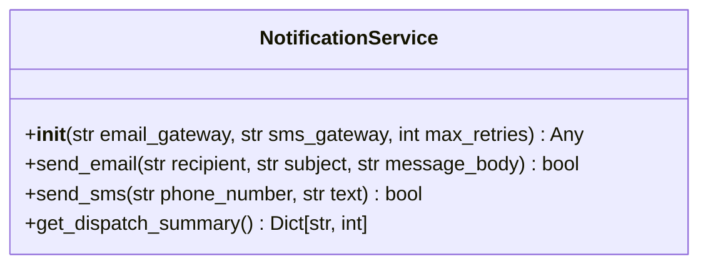

# Class: `NotificationService`

> **Language**: `PYTHON` | **Engine**: `GEMINI` | **Source**: [`src/notification_service.py`](../../src/notification_service.py#L11-L56) | **Lines**: `11 - 56`

---

## 1. Overview & Architectural Purpose

Manages notification gateway configurations and maintains an in-memory dispatch history for email and SMS alerts.

### Design Rationale
INFERRED: Encapsulates notification dispatch logic under a unified interface using dependency injection for gateway configurations to separate dispatch configuration from message creation.

---

## 2. Key Responsibilities & Capabilities

- Initialize and store gateway endpoints and retry configurations (Lines 16-23).
- Perform basic input validation for email and SMS parameters (Lines 29-30, 40-41).
- Record email and SMS dispatch events in an internal in-memory history list (Lines 32-33, 43-44).
- Aggregate and count recorded dispatch events grouped by channel (Lines 51-56).

---

## 3. Method Signatures & Behavioral Analysis

| Method Name | Parameters | Return Type | Lines | Explanation |
| :--- | :--- | :--- | :--- | :--- |
| **`__init__`** | `self: Any`, `email_gateway: str`, `sms_gateway: str`, `max_retries: int` | `Any` | L16-L23 | Assigns gateway parameters, sets retry limits, and initializes an empty `dispatch_history` list. |
| **`send_email`** | `self: Any`, `recipient: str`, `subject: str`, `message_body: str` | `bool` | L25-L34 | Checks that recipient and message_body are non-empty, appends a dict record with channel 'email' and status 'sent' to history, and returns True if valid or False if invalid. |
| **`send_sms`** | `self: Any`, `phone_number: str`, `text: str` | `bool` | L36-L45 | Checks that phone_number is present and at least 10 characters long, appends a dict record with channel 'sms' and status 'queued' to history, and returns True if valid or False if invalid. |
| **`get_dispatch_summary`** | `self: Any` | `Dict[str, int]` | L47-L56 | Iterates through `dispatch_history` and returns a dictionary containing total counts for 'email' and 'sms' channels. |

---

## 4. Injected Dependencies & Collaborators

- **`email_gateway`**: String parameter specifying the target gateway endpoint or provider identifier for email dispatch (Lines 16, 20).
- **`sms_gateway`**: String parameter specifying the target gateway endpoint or provider identifier for SMS dispatch (Lines 16, 21).
- **`max_retries`**: Integer specifying the retry threshold, defaulting to 3 (Lines 16, 22).

---

## 5. Verifiable Code Citations

- Lines 16-23: Sets instance attributes `email_gateway`, `sms_gateway`, `max_retries`, and `dispatch_history`.
- Lines 29-34: Validates email inputs and appends `{'channel': 'email', 'to': recipient, 'status': 'sent'}` to `dispatch_history`.
- Lines 40-45: Validates phone string length (< 10) and appends `{'channel': 'sms', 'to': phone_number, 'status': 'queued'}` to `dispatch_history`.
- Lines 51-56: Tallies occurrences of recorded channels inside `dispatch_history` and returns summary dict.

---

## 6. Known Architectural Boundaries & Limitations

- ⚠️ No actual network calls, HTTP requests, or external SDK calls are performed in this class; cross-file inspection is required to determine how gateways actually transmit messages.
- ⚠️ Dispatch history is stored entirely in memory (`self.dispatch_history`) and is lost when the instance is destroyed.
- ⚠️ The `max_retries` attribute is stored during initialization (Line 22) but is never read or used anywhere in the class.
- ⚠️ Validation is minimal (e.g., checking length >= 10 for phone numbers without format or regex validation).

---

## 7. Structural Class Diagram (Mermaid)

---
*Auto-generated by Code Documentation Engine.*
