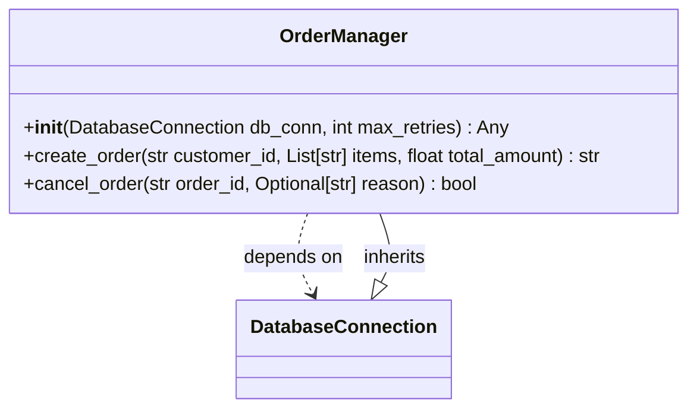

# Class: `OrderManager`

> **Language**: `PYTHON` | **Source**: [`sample_project\order_manager.py`](../../sample_project\order_manager.py#L8-L23) | **Lines**: `8 - 23`

---

## 1. Class Architecture Diagram

---

## 2. Overview & Purpose

Manages order creation, lifecycle states, and customer notifications.

### Why this class exists (Design Rationale)
Implements inheritance/interface contract from `DatabaseConnection` ensuring substitutability. Employs Dependency Injection via constructor parameters to decouple implementations from caller code.

---

## 3. Key Responsibilities

- Initializes dependencies: db_conn, max_retries.
- Provides operation `create_order`.
- Provides operation `cancel_order`.

---

## 4. Method Signatures & Behavioral Analysis

| Method Name | Parameters | Return Type | Lines | Explanation |
| :--- | :--- | :--- | :--- | :--- |
| **`__init__`** | `self: Any`, `db_conn: DatabaseConnection`, `max_retries: int` | `Any` | L12-L14 | Executes method logic. |
| **`create_order`** | `self: Any`, `customer_id: str`, `items: List[str]`, `total_amount: float` | `str` | L16-L19 | Creates a pending order in the database and returns an Order ID. |
| **`cancel_order`** | `self: Any`, `order_id: str`, `reason: Optional[str]` | `bool` | L21-L23 | Cancels an existing pending order. |

---

## 5. Injected Dependencies & Collaborators

- **`db_conn: DatabaseConnection`**: Injected dependency used for delegating operations.
- **`max_retries: int`**: Injected dependency used for delegating operations.

---

## 6. Verifiable Code Citations

- Lines 8-23: Declares `OrderManager` in `sample_project\order_manager.py`.
- Lines 12-14: Constructor initialization.
- Lines 16-19: Defines method `create_order`.
- Lines 21-23: Defines method `cancel_order`.

---

## 7. Known Architectural Boundaries & Limitations

- ⚠️ End-to-end integration requires inspecting classes calling or referenced by `OrderManager`.
- ⚠️ Underlying data persistence and network latency characteristics depend on external runtime configuration.

---
*Auto-generated by GitHub Pipeline Code Documentation Engine.*
