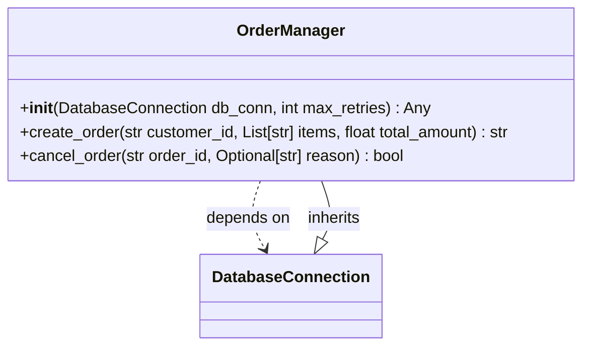

# Class: `OrderManager`

> **Language**: `PYTHON` | **Source**: [`tests\sample_code\order_manager.py`](../../tests\sample_code\order_manager.py#L31-L77) | **Lines**: `31 - 77`

---

## 1. Class Architecture Diagram

---

## 2. Overview & Purpose

Coordinates order lifecycle, payment delegation, and customer state transitions.

### Why this class exists (Design Rationale)
Implements inheritance/interface contract from `DatabaseConnection` ensuring substitutability and polymorphism. Employs Dependency Injection via constructor parameters to decouple implementations from caller code.

---

## 3. Key Responsibilities

- Initializes instance dependencies: db_conn, max_retries.
- Provides operation `create_order`.
- Provides operation `cancel_order`.

---

## 4. Method Signatures & Behavioral Analysis

| Method Name | Parameters | Return Type | Lines | Explanation |
| :--- | :--- | :--- | :--- | :--- |
| **`__init__`** | `self: Any`, `db_conn: DatabaseConnection`, `max_retries: int` | `Any` | L38-L47 | Initializes the OrderManager with an injected database connection.
        
        Args:
            db_conn (DatabaseConnection): Injected database connection handler.
            max_retries (int): Maximum number of retry attempts for transient failures. |
| **`create_order`** | `self: Any`, `customer_id: str`, `items: List[str]`, `total_amount: float` | `str` | L49-L63 | Validates order parameters, calculates taxes, and persists a pending order.
        
        Args:
            customer_id (str): Unique customer UUID or identifier.
            items (List[str]): List of SKU item codes to be ordered.
            total_amount (float): Calculated financial total for the cart.
            
        Returns:
            str: Generated unique Order Reference ID (e.g. 'ORD-CUST'). |
| **`cancel_order`** | `self: Any`, `order_id: str`, `reason: Optional[str]` | `bool` | L65-L77 | Cancels an unfulfilled pending order and initiates reversal workflows.
        
        Args:
            order_id (str): The identifier of the order to cancel.
            reason (Optional[str]): Optional human-readable cancellation rationale.
            
        Returns:
            bool: True if the cancellation succeeded. |

---

## 5. Injected Dependencies & Collaborators

- **`db_conn: DatabaseConnection`**: Injected collaborator utilized for delegating specialized operations.
- **`max_retries: int`**: Injected collaborator utilized for delegating specialized operations.

---

## 6. Verifiable Code Citations

- Lines 31-77: Declares `OrderManager` in `tests\sample_code\order_manager.py`.
- Lines 38-47: Constructor initialization.
- Lines 49-63: Defines method `create_order`.
- Lines 65-77: Defines method `cancel_order`.

---

## 7. Known Architectural Boundaries & Limitations

- ⚠️ End-to-end integration requires inspecting classes calling or referenced by `OrderManager`.
- ⚠️ Underlying data persistence and network latency characteristics depend on external runtime configuration.

---
*Auto-generated by GitHub Pipeline Code Documentation Engine.*
