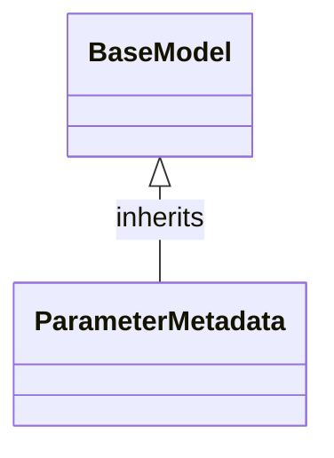

# Class: `ParameterMetadata`

> **Language**: `PYTHON` | **Engine**: `GROUNDED_HEURISTIC` | **Source**: [`analyzer/models/schemas.py`](../../analyzer/models/schemas.py#L13-L17) | **Lines**: `13 - 17`

---

## 1. Overview & Architectural Purpose

Represents an individual method/function parameter.

### Design Rationale
Implements inheritance/interface contract from `BaseModel` ensuring substitutability and polymorphism.

---

## 2. Key Responsibilities & Capabilities

---

## 3. Method Signatures & Behavioral Analysis

| Method Name | Parameters | Return Type | Lines | Explanation |
| :--- | :--- | :--- | :--- | :--- |

---

## 5. Verifiable Code Citations

- Lines 13-17: Declares `ParameterMetadata` in `analyzer/models/schemas.py`.

---

## 6. Known Architectural Boundaries & Limitations

- ⚠️ End-to-end integration requires inspecting classes calling or referenced by `ParameterMetadata`.
- ⚠️ Underlying data persistence and network latency characteristics depend on external runtime configuration.

---

## 7. Structural Class Diagram (Mermaid)

---
*Auto-generated by Code Documentation Engine.*
