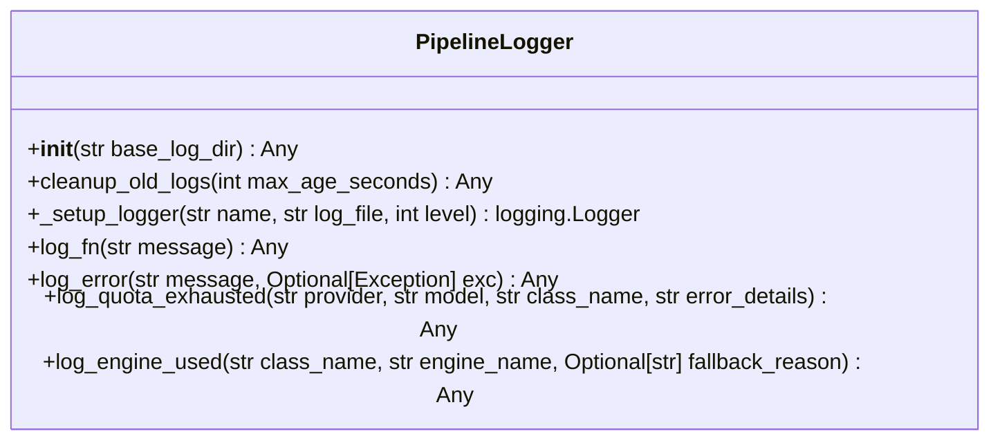

# Class: `PipelineLogger`

> **Language**: `PYTHON` | **Engine**: `GROUNDED_HEURISTIC` | **Source**: [`analyzer/utils/logger.py`](../../analyzer/utils/logger.py#L19-L134) | **Lines**: `19 - 134`

---

## 1. Class Architecture Diagram

---

## 2. Overview & Purpose

Manages three distinct log streams directing output to their respective directories.

### Why this class exists (Design Rationale)
Employs Dependency Injection via constructor parameters to decouple implementations from caller code.

---

## 3. Key Responsibilities

- Initializes instance dependencies: base_log_dir.
- Provides operation `cleanup_old_logs`.
- Provides operation `_setup_logger`.
- Provides operation `log_fn`.
- Provides operation `log_error`.
- Provides operation `log_quota_exhausted`.
- Provides operation `log_engine_used`.

---

## 4. Method Signatures & Behavioral Analysis

| Method Name | Parameters | Return Type | Lines | Explanation |
| :--- | :--- | :--- | :--- | :--- |
| **`__init__`** | `self: Any`, `base_log_dir: str` | `Any` | L25-L48 | Executes method logic. |
| **`cleanup_old_logs`** | `self: Any`, `max_age_seconds: int` | `Any` | L50-L79 | Maintains only the logs generated within the last 1 hour (max_age_seconds).
        Automatically removes older log files across err_log, fn_log, and quota_complete_log. |
| **`_setup_logger`** | `self: Any`, `name: str`, `log_file: str`, `level: int` | `logging.Logger` | L81-L96 | Executes `_setup_logger` accepting 4 parameter(s) and returning `logging.Logger`. |
| **`log_fn`** | `self: Any`, `message: str` | `Any` | L99-L101 | Records normal lifecycle operational events. |
| **`log_error`** | `self: Any`, `message: str`, `exc: Optional[Exception]` | `Any` | L104-L109 | Records runtime exceptions and failures. |
| **`log_quota_exhausted`** | `self: Any`, `provider: str`, `model: str`, `class_name: str`, `error_details: str` | `Any` | L112-L122 | Records when API quota is exhausted (429 / resource exhausted)
        and documents the automatic switch to the Heuristic Engine. |
| **`log_engine_used`** | `self: Any`, `class_name: str`, `engine_name: str`, `fallback_reason: Optional[str]` | `Any` | L125-L134 | Records the specific engine (GEMINI, CLAUDE, MISTRAL, or GROUNDED_HEURISTIC)
        used to generate documentation for a given class. |

---

## 5. Injected Dependencies & Collaborators

- **`base_log_dir: str`**: Injected collaborator utilized for delegating specialized operations.

---

## 6. Verifiable Code Citations

- Lines 19-134: Declares `PipelineLogger` in `analyzer/utils/logger.py`.
- Lines 25-48: Constructor initialization.
- Lines 50-79: Defines method `cleanup_old_logs`.
- Lines 81-96: Defines method `_setup_logger`.
- Lines 99-101: Defines method `log_fn`.
- Lines 104-109: Defines method `log_error`.
- Lines 112-122: Defines method `log_quota_exhausted`.
- Lines 125-134: Defines method `log_engine_used`.

---

## 7. Known Architectural Boundaries & Limitations

- ⚠️ End-to-end integration requires inspecting classes calling or referenced by `PipelineLogger`.
- ⚠️ Underlying data persistence and network latency characteristics depend on external runtime configuration.

---
*Auto-generated by GitHub Pipeline Code Documentation Engine.*
