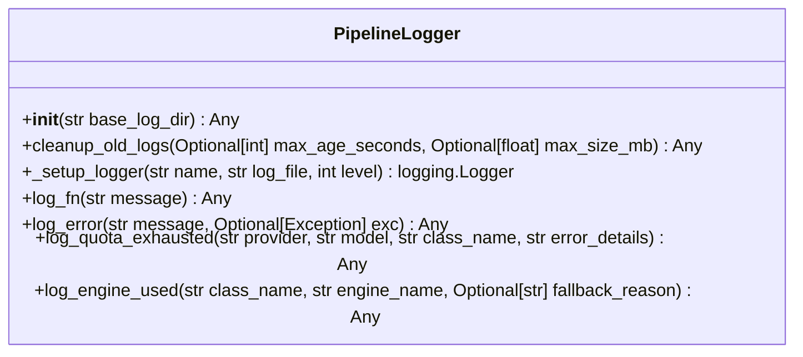

# Class: `PipelineLogger`

> **Language**: `PYTHON` | **Engine**: `GEMINI` | **Source**: [`analyzer/utils/logger.py`](../../analyzer/utils/logger.py#L19-L182) | **Lines**: `19 - 182`

---

## 1. Class Architecture Diagram

---

## 2. Overview & Purpose

Manages three specialized file-based log streams (operational, error, and quota limit logs) within dedicated subdirectories and enforces log cleanup based on age and total directory size constraints.

### Why this class exists (Design Rationale)
OBSERVED: Encapsulates distinct log stream management and custom maintenance routines (age and size-based purging) into a single utility class.
INFERRED: Isolates logging directory setup and cleanup mechanics from core pipeline analysis logic, ensuring consistent file logging formatting and preventing unlimited disk utilization across repeated analysis runs.

---

## 3. Key Responsibilities

- Initialize log subdirectories ('err_log', 'fn_log', 'quota_complete_log') and create session-bound log file paths (Lines 25-39).
- Configure three distinct Python standard library loggers (`pipeline_fn`, `pipeline_err`, `pipeline_quota`) with custom formatting and propagation disabled (Lines 40-44, 125-139).
- Purge non-active `.log` files that exceed configured age thresholds or push total log directory size beyond configured megabyte limits (Lines 49-123).
- Provide operational logging methods for general pipeline events, runtime errors/exceptions, API quota exhaustion warnings, and engine attribution (Lines 142-182).

---

## 4. Method Signatures & Behavioral Analysis

| Method Name | Parameters | Return Type | Lines | Explanation |
| :--- | :--- | :--- | :--- | :--- |
| **`__init__`** | `self: Any`, `base_log_dir: str` | `Any` | L25-L48 | Sets up target log directories, derives timestamped log filenames for the current session, configures three logger instances, and runs initial log cleanup. Returns None (Lines 25-47). |
| **`cleanup_old_logs`** | `self: Any`, `max_age_seconds: Optional[int]`, `max_size_mb: Optional[float]` | `Any` | L50-L127 | Performs age-based and size-based deletion of existing log files across managed subdirectories, skipping current active session log files. Returns None (Lines 49-123). |
| **`_setup_logger`** | `self: Any`, `name: str`, `log_file: str`, `level: int` | `logging.Logger` | L129-L144 | Constructs and returns a `logging.Logger` instance with non-propagating behavior and a formatted UTF-8 `FileHandler` if no handlers are already attached (Lines 125-139). |
| **`log_fn`** | `self: Any`, `message: str` | `Any` | L147-L149 | Logs an operational event message at INFO level to `fn_logger`. Returns None (Lines 142-144). |
| **`log_error`** | `self: Any`, `message: str`, `exc: Optional[Exception]` | `Any` | L152-L157 | Logs an error message to `err_logger` at ERROR level, including exception stack traces (`exc_info=True`) when an Exception is provided. Returns None (Lines 147-152). |
| **`log_quota_exhausted`** | `self: Any`, `provider: str`, `model: str`, `class_name: str`, `error_details: str` | `Any` | L160-L170 | Formats and logs a warning regarding API provider quota depletion and automatic fallback to the Heuristic Engine to `quota_logger`. Returns None (Lines 155-167). |
| **`log_engine_used`** | `self: Any`, `class_name: str`, `engine_name: str`, `fallback_reason: Optional[str]` | `Any` | L173-L182 | Logs which documentation engine was selected for a given class (and optional fallback reason) at INFO level to `fn_logger`. Returns None (Lines 170-182). |

---

## 5. Injected Dependencies & Collaborators

- **`base_log_dir`**: String path indicating the base directory under which log subdirectories ('err_log', 'fn_log', 'quota_complete_log') are established (Lines 25-29).
- **`analyzer.utils.config_loader.load_config`**: Dynamically imported within `cleanup_old_logs` to fetch logging thresholds (`max_age_hours`, `max_size_mb`) if explicit arguments are omitted (Lines 57-62). Requires cross-file inspection to verify underlying schema.
- **`logging`**: Python standard library logging module used to instantiate loggers, assign log levels, and attach UTF-8 `FileHandler` instances (Lines 125-139).
- **`os / re / datetime`**: Standard utilities used for file path operations, directory creation, log file modification time checks, regex parsing of timestamped filenames, and current time calculation (Lines 25-123).

---

## 6. Verifiable Code Citations

- Lines 27-29: Directory path construction using `os.path.join` for `err_dir`, `fn_dir`, and `quota_dir`.
- Lines 32-34: Directory creation via `os.makedirs(..., exist_ok=True)`.
- Lines 37-39: Session ID generation using `datetime.now().strftime("%Y-%m-%d_%H-%M-%S")`.
- Lines 41-43: Logger setup calls mapping distinct names, levels (`logging.INFO`, `logging.ERROR`, `logging.WARNING`), and target files.
- Lines 57-68: Dynamic import of `load_config` with fallback default values (3600 seconds, 10.0 MB) on failure.
- Lines 71-96: Age-based log file deletion using regex timestamp extraction or `os.path.getmtime`.
- Lines 98-123: Size-based log file deletion sorted by modification timestamp until total directory size is under `max_bytes`.
- Lines 127-136: Disabling logger propagation (`logger.propagate = False`) and adding a `FileHandler` formatted with standard time and log level.

---

## 7. Known Architectural Boundaries & Limitations

- ⚠️ Silent Exception Handling: In `cleanup_old_logs`, exceptions during config loading (Lines 63-68) and file removal (Lines 94-95, 121-122) are caught with bare `except Exception: pass`, which masks permission errors or unhandled file lock issues.
- ⚠️ Concurrency Risks: If multiple processes instantiate `PipelineLogger` within the exact same second, they will generate duplicate session log filenames, causing file handler collision.
- ⚠️ External Config Dependency: Full verification of configuration parameter fallback requires cross-file inspection of `analyzer.utils.config_loader`.

---
*Auto-generated by GitHub Pipeline Code Documentation Engine.*
