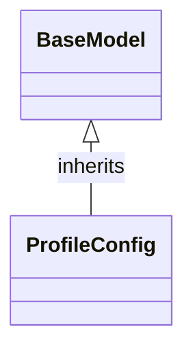

# Class: `ProfileConfig`

> **Language**: `PYTHON` | **Engine**: `GEMINI` | **Source**: [`analyzer/utils/config_loader.py`](../../analyzer/utils/config_loader.py#L19-L28) | **Lines**: `19 - 28`

---

## 1. Class Architecture Diagram

---

## 2. Overview & Purpose

Defines the data structure and default parameters for an individual LLM environment profile configuration.

### Why this class exists (Design Rationale)
INFERRED: Encapsulates environment-specific LLM execution parameters within a Pydantic model to enforce consistent typing, supply sensible default values, and enable structured configuration parsing.

---

## 3. Key Responsibilities

- Hold configuration settings required to interact with an LLM provider (e.g., provider name, endpoint URL, API key, model target).
- Specify runtime behavior settings such as execution enable/disable flags, sampling temperature, and network timeouts.
- Provide default configuration values for local/production LLM settings.

---

## 4. Method Signatures & Behavioral Analysis

| Method Name | Parameters | Return Type | Lines | Explanation |
| :--- | :--- | :--- | :--- | :--- |

---

## 6. Verifiable Code Citations

- Line 19: Class definition declaring `ProfileConfig` inheriting from `BaseModel`.
- Line 21: `provider` defined with default value 'gemini' and supported provider options in description.
- Line 22: `description` declared as `Optional[str]` defaulting to `None`.
- Line 23: `enabled` boolean flag defaulting to `False`.
- Line 24: `api_key` declared as `Optional[str]` defaulting to an empty string `""`.
- Line 25: `api_base` defined with default endpoint URL 'https://generativelanguage.googleapis.com/v1beta/openai'.
- Line 26: `model` string identifier defaulting to 'gemini-3.5-flash'.
- Line 27: `temperature` float defaulting to 0.1.
- Line 28: `timeout_seconds` integer defaulting to 30.

---

## 7. Known Architectural Boundaries & Limitations

- ⚠️ No runtime validation exists within this class to verify if `api_key` is set when `enabled` is True.
- ⚠️ No explicit URL validation is performed on `api_base` beyond basic string assignment.
- ⚠️ Cross-file inspection is required to determine how instances of this class are instantiated, loaded from files, or consumed by API client services.

---
*Auto-generated by GitHub Pipeline Code Documentation Engine.*
