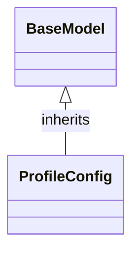

# Class: `ProfileConfig`

> **Language**: `PYTHON` | **Engine**: `GEMINI` | **Source**: [`analyzer/utils/config_loader.py`](../../analyzer/utils/config_loader.py#L19-L28) | **Lines**: `19 - 28`

---

## 1. Overview & Architectural Purpose

Defines a structured data schema and default settings for an individual LLM environment configuration profile.

### Design Rationale
INFERRED: Leverages Pydantic's BaseModel to enforce type safety, explicit data structure, and reasonable defaults for individual environment configuration profiles, separating raw configuration data from instantiation logic.

---

## 2. Key Responsibilities & Capabilities

- Define schema fields for an LLM environment profile including provider identifier, model name, base URL endpoint, API key, and call parameters.
- Supply default configuration values for fields such as provider ('gemini'), model ('gemini-3.5-flash'), temperature (0.1), and timeout_seconds (30).

---

## 3. Method Signatures & Behavioral Analysis

| Method Name | Parameters | Return Type | Lines | Explanation |
| :--- | :--- | :--- | :--- | :--- |

---

## 5. Verifiable Code Citations

- Line 19: Class declaration inheriting from BaseModel
- Line 20: Docstring defining class purpose as environment profile configuration
- Lines 21-28: Field assignments for provider, description, enabled, api_key, api_base, model, temperature, and timeout_seconds

---

## 6. Known Architectural Boundaries & Limitations

- ⚠️ No observed dynamic validation or custom validators for api_base URL structure or api_key formatting; cross-file inspection required to verify if external validation exists.
- ⚠️ No observable methods for loading profiles from disk or environment variables directly within this class; cross-file inspection required to see how this model is populated.

---

## 7. Structural Class Diagram (Mermaid)

---
*Auto-generated by Code Documentation Engine.*
