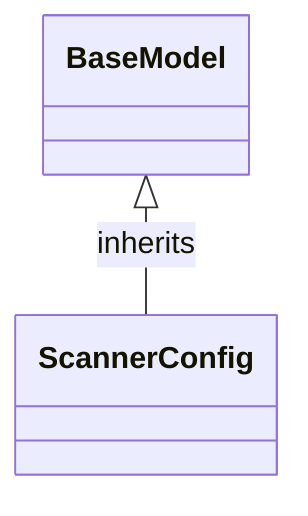

# Class: `ScannerConfig`

> **Language**: `PYTHON` | **Engine**: `GEMINI` | **Source**: [`analyzer/utils/config_loader.py`](../../analyzer/utils/config_loader.py#L38-L53) | **Lines**: `38 - 53`

---

## 1. Class Architecture Diagram

---

## 2. Overview & Purpose

Provides configuration settings for repository file discovery, specifically defining supported source code file extensions and directories to ignore.

### Why this class exists (Design Rationale)
OBSERVED: Uses Pydantic's BaseModel and Field with default_factory lambdas to define typed attributes and standard defaults for scanning. INFERRED: Encapsulates scanning configuration into a dedicated model to separate file discovery criteria from the logic executing the search, enabling clean configuration passing and serialization.

---

## 3. Key Responsibilities

- Define and hold the default list of file extensions allowed during repository scanning.
- Define and hold the default list of directory names to skip during recursive file searching.

---

## 4. Method Signatures & Behavioral Analysis

| Method Name | Parameters | Return Type | Lines | Explanation |
| :--- | :--- | :--- | :--- | :--- |

---

## 6. Verifiable Code Citations

- Lines 38-39: Declares `ScannerConfig` inheriting from `BaseModel` with docstring 'Configuration for repository file discovery.'
- Lines 40-46: Defines `supported_extensions` as `List[str]` with a default factory returning common source code file extensions.
- Lines 47-53: Defines `ignored_directories` as `List[str]` with a default factory returning build, toolchain, and hidden directory names to skip.

---

## 7. Known Architectural Boundaries & Limitations

- ⚠️ No custom input validation or normalization (e.g., lowercase enforcement or path separator stripping) is implemented on the fields in this class; cross-file inspection is required to verify if sanitization occurs elsewhere.
- ⚠️ Does not execute file scanning or perform I/O operations itself; cross-file inspection is needed to see how these configuration values are consumed.
- ⚠️ Cross-file inspection is required to determine how configuration overrides (such as loading from disk or environment variables) are applied to this model.

---
*Auto-generated by GitHub Pipeline Code Documentation Engine.*
