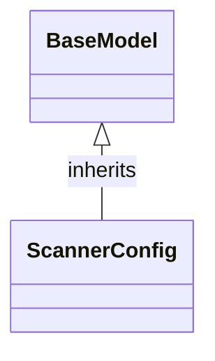

# Class: `ScannerConfig`

> **Language**: `PYTHON` | **Engine**: `GEMINI` | **Source**: [`analyzer/utils/config_loader.py`](../../analyzer/utils/config_loader.py#L38-L53) | **Lines**: `38 - 53`

---

## 1. Class Architecture Diagram

---

## 2. Overview & Purpose

Defines configuration settings for repository file discovery, specifying default source code extensions to scan and directories to ignore.

### Why this class exists (Design Rationale)
Encapsulates repository scanning parameters within a typed data structure using Pydantic, enabling default configurations while allowing structured validation and override capabilities.

---

## 3. Key Responsibilities

- Provide a default list of target source code file extensions for file discovery.
- Provide a default list of directory names to exclude during recursive repository traversal.

---

## 4. Method Signatures & Behavioral Analysis

| Method Name | Parameters | Return Type | Lines | Explanation |
| :--- | :--- | :--- | :--- | :--- |

---

## 6. Verifiable Code Citations

- Line 38: Defines ScannerConfig inheriting from BaseModel.
- Lines 40-46: Defines supported_extensions field using Field with a default_factory returning target extensions.
- Lines 47-53: Defines ignored_directories field using Field with a default_factory returning directories to skip.

---

## 7. Known Architectural Boundaries & Limitations

- ⚠️ Requires cross-file inspection to determine how instances are instantiated, validated against external files, or consumed by scanning modules.
- ⚠️ Does not explicitly define custom validation rules or methods for dynamic modification of extensions or ignored directories.

---
*Auto-generated by GitHub Pipeline Code Documentation Engine.*
