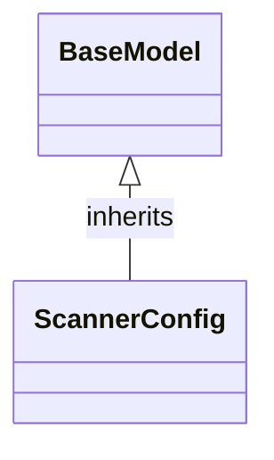

# Class: `ScannerConfig`

> **Language**: `PYTHON` | **Engine**: `GEMINI` | **Source**: [`analyzer/utils/config_loader.py`](../../analyzer/utils/config_loader.py#L38-L53) | **Lines**: `38 - 53`

---

## 1. Overview & Architectural Purpose

Provides configuration settings for repository file discovery by defining default file extensions to scan and directory names to skip.

### Design Rationale
[INFERRED] Inherits from Pydantic's BaseModel to establish a structured data model with type safety and default field values for file discovery mechanisms.

---

## 2. Key Responsibilities & Capabilities

- Maintain a default list of supported source code file extensions.
- Maintain a default list of directory names to ignore during recursive file searches.

---

## 3. Method Signatures & Behavioral Analysis

| Method Name | Parameters | Return Type | Lines | Explanation |
| :--- | :--- | :--- | :--- | :--- |

---

## 5. Verifiable Code Citations

- Line 38: Class declaration ScannerConfig(BaseModel) with docstring 'Configuration for repository file discovery.'
- Lines 40-46: Definition of supported_extensions field with default_factory returning a list of 11 source code extensions.
- Lines 47-53: Definition of ignored_directories field with default_factory returning a list of 12 directory names to skip.

---

## 6. Known Architectural Boundaries & Limitations

- ⚠️ No explicit validation rules or constraints beyond standard Pydantic type checking are defined in this class.
- ⚠️ How this configuration is loaded from files or overridden at runtime requires cross-file inspection of the rest of config_loader.py or consuming modules.

---

## 7. Structural Class Diagram (Mermaid)

---
*Auto-generated by Code Documentation Engine.*
