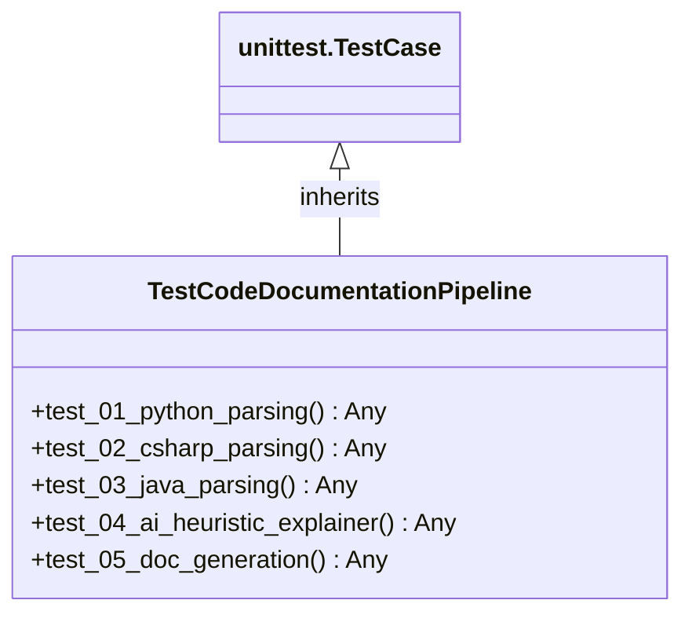

# Class: `TestCodeDocumentationPipeline`

> **Language**: `PYTHON` | **Source**: [`tests\test_pipeline.py`](../../tests\test_pipeline.py#L25-L109) | **Lines**: `25 - 109`

---

## 1. Class Architecture Diagram

---

## 2. Overview & Purpose

Test cases for the universal code documentation engine.

### Why this class exists (Design Rationale)
Implements inheritance/interface contract from `unittest.TestCase` ensuring substitutability and polymorphism.

---

## 3. Key Responsibilities

- Provides operation `test_01_python_parsing`.
- Provides operation `test_02_csharp_parsing`.
- Provides operation `test_03_java_parsing`.
- Provides operation `test_04_ai_heuristic_explainer`.
- Provides operation `test_05_doc_generation`.

---

## 4. Method Signatures & Behavioral Analysis

| Method Name | Parameters | Return Type | Lines | Explanation |
| :--- | :--- | :--- | :--- | :--- |
| **`test_01_python_parsing`** | `self: Any` | `Any` | L35-L50 | Verify Python AST extracts classes, inheritance, and methods. |
| **`test_02_csharp_parsing`** | `self: Any` | `Any` | L52-L62 | Verify C# AST extracts interfaces, base_list, and DI dependencies. |
| **`test_03_java_parsing`** | `self: Any` | `Any` | L64-L75 | Verify Java AST extracts classes, formal parameters, and return types. |
| **`test_04_ai_heuristic_explainer`** | `self: Any` | `Any` | L77-L87 | Verify the deterministic heuristic fallback produces grounded output without LLM API key. |
| **`test_05_doc_generation`** | `self: Any` | `Any` | L89-L102 | Verify Markdown and Mermaid diagram generation. |

---

## 6. Verifiable Code Citations

- Lines 25-109: Declares `TestCodeDocumentationPipeline` in `tests\test_pipeline.py`.
- Lines 35-50: Defines method `test_01_python_parsing`.
- Lines 52-62: Defines method `test_02_csharp_parsing`.
- Lines 64-75: Defines method `test_03_java_parsing`.
- Lines 77-87: Defines method `test_04_ai_heuristic_explainer`.
- Lines 89-102: Defines method `test_05_doc_generation`.

---

## 7. Known Architectural Boundaries & Limitations

- ⚠️ End-to-end integration requires inspecting classes calling or referenced by `TestCodeDocumentationPipeline`.
- ⚠️ Underlying data persistence and network latency characteristics depend on external runtime configuration.

---
*Auto-generated by GitHub Pipeline Code Documentation Engine.*
