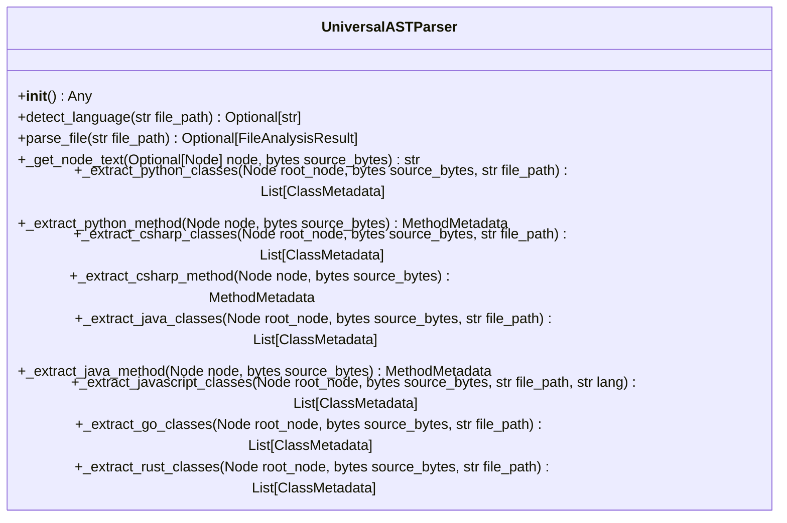

# Class: `UniversalASTParser`

> **Language**: `PYTHON` | **Engine**: `GROUNDED_HEURISTIC` | **Source**: [`analyzer\parser.py`](../../analyzer\parser.py#L48-L755) | **Lines**: `48 - 755`

---

## 1. Class Architecture Diagram

---

## 2. Overview & Purpose

Orchestrates grammar loading and syntax tree traversal across multiple languages:

### Why this class exists (Design Rationale)
Encapsulates specialized methods and state within a dedicated class unit adhering to single responsibility principles.

---

## 3. Key Responsibilities

- Initializes instance dependencies: None.
- Provides operation `detect_language`.
- Provides operation `parse_file`.
- Provides operation `_get_node_text`.
- Provides operation `_extract_python_classes`.
- Provides operation `_extract_python_method`.
- Provides operation `_extract_csharp_classes`.
- Provides operation `_extract_csharp_method`.
- Provides operation `_extract_java_classes`.
- Provides operation `_extract_java_method`.
- Provides operation `_extract_javascript_classes`.
- Provides operation `_extract_go_classes`.
- Provides operation `_extract_rust_classes`.

---

## 4. Method Signatures & Behavioral Analysis

| Method Name | Parameters | Return Type | Lines | Explanation |
| :--- | :--- | :--- | :--- | :--- |
| **`__init__`** | `self: Any` | `Any` | L54-L117 | Initializes language grammars and parser instances for supported languages. |
| **`detect_language`** | `self: Any`, `file_path: str` | `Optional[str]` | L119-L137 | Maps a file extension to its corresponding parser language key. |
| **`parse_file`** | `self: Any`, `file_path: str` | `Optional[FileAnalysisResult]` | L139-L176 | Reads a source file, parses its AST, and extracts structured class metadata. |
| **`_get_node_text`** | `self: Any`, `node: Optional[Node]`, `source_bytes: bytes` | `str` | L178-L182 | Helper to extract and decode substring bounded by a Tree-sitter node. |
| **`_extract_python_classes`** | `self: Any`, `root_node: Node`, `source_bytes: bytes`, `file_path: str` | `List[ClassMetadata]` | L187-L244 | Traverses Python AST to extract classes, bases, dependencies, and methods. |
| **`_extract_python_method`** | `self: Any`, `node: Node`, `source_bytes: bytes` | `MethodMetadata` | L246-L285 | Parses a Python function_definition node into structured MethodMetadata. |
| **`_extract_csharp_classes`** | `self: Any`, `root_node: Node`, `source_bytes: bytes`, `file_path: str` | `List[ClassMetadata]` | L290-L343 | Traverses C# AST extracting classes, interfaces, base_list, and DI constructors. |
| **`_extract_csharp_method`** | `self: Any`, `node: Node`, `source_bytes: bytes` | `MethodMetadata` | L345-L370 | Parses a C# method_declaration node into MethodMetadata. |
| **`_extract_java_classes`** | `self: Any`, `root_node: Node`, `source_bytes: bytes`, `file_path: str` | `List[ClassMetadata]` | L375-L424 | Traverses Java AST extracting classes, interfaces, superclasses, and methods. |
| **`_extract_java_method`** | `self: Any`, `node: Node`, `source_bytes: bytes` | `MethodMetadata` | L426-L451 | Parses a Java method_declaration node into MethodMetadata. |
| **`_extract_javascript_classes`** | `self: Any`, `root_node: Node`, `source_bytes: bytes`, `file_path: str`, `lang: str` | `List[ClassMetadata]` | L456-L595 | Traverses JS/TS/JSX/TSX AST to extract ES6 classes, TypeScript interfaces,
        and React functional/arrow components. |
| **`_extract_go_classes`** | `self: Any`, `root_node: Node`, `source_bytes: bytes`, `file_path: str` | `List[ClassMetadata]` | L600-L677 | Traverses Go AST to extract structs and their associated receiver methods. |
| **`_extract_rust_classes`** | `self: Any`, `root_node: Node`, `source_bytes: bytes`, `file_path: str` | `List[ClassMetadata]` | L682-L755 | Traverses Rust AST to extract struct items and associated impl blocks. |

---

## 6. Verifiable Code Citations

- Lines 48-755: Declares `UniversalASTParser` in `analyzer\parser.py`.
- Lines 54-117: Constructor initialization.
- Lines 119-137: Defines method `detect_language`.
- Lines 139-176: Defines method `parse_file`.
- Lines 178-182: Defines method `_get_node_text`.
- Lines 187-244: Defines method `_extract_python_classes`.
- Lines 246-285: Defines method `_extract_python_method`.
- Lines 290-343: Defines method `_extract_csharp_classes`.
- Lines 345-370: Defines method `_extract_csharp_method`.
- Lines 375-424: Defines method `_extract_java_classes`.
- Lines 426-451: Defines method `_extract_java_method`.
- Lines 456-595: Defines method `_extract_javascript_classes`.
- Lines 600-677: Defines method `_extract_go_classes`.
- Lines 682-755: Defines method `_extract_rust_classes`.

---

## 7. Known Architectural Boundaries & Limitations

- ⚠️ End-to-end integration requires inspecting classes calling or referenced by `UniversalASTParser`.
- ⚠️ Underlying data persistence and network latency characteristics depend on external runtime configuration.

---
*Auto-generated by GitHub Pipeline Code Documentation Engine.*
