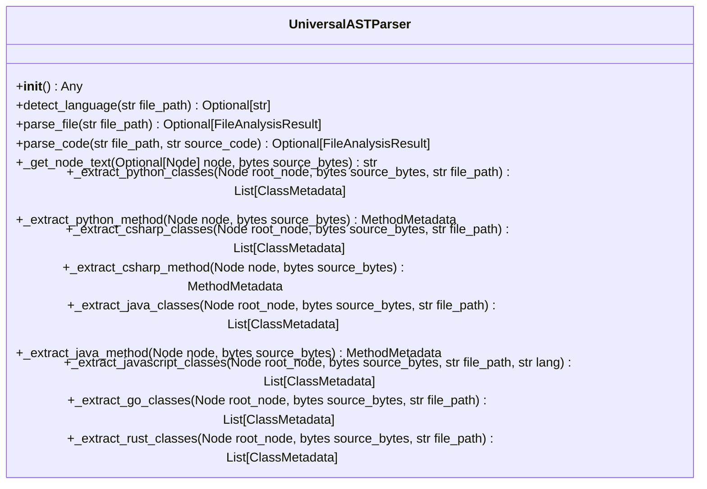

# Class: `UniversalASTParser`

> **Language**: `PYTHON` | **Engine**: `GEMINI` | **Source**: [`analyzer/parser.py`](../../analyzer/parser.py#L48-L762) | **Lines**: `48 - 762`

---

## 1. Overview & Architectural Purpose

Orchestrates multi-language grammar loading and AST traversal to extract structured class, interface, component, and method metadata across Python, C#, Java, JavaScript, TypeScript, TSX, Go, and Rust.

### Design Rationale
OBSERVED: Encapsulates grammar instantiation, parser management, file reading, and AST node parsing in a single class with language-specific extraction routines. INFERRED: Centralizes language extension mapping and AST node traversal into a uniform interface (`parse_code`/`parse_file`) to decouple downstream consumers from multi-language parsing complexities.

---

## 2. Key Responsibilities & Capabilities

- Instantiate and maintain language grammars and Tree-sitter Parser instances for supported languages.
- Map file extensions to corresponding language identifiers.
- Read file contents or receive raw source code strings and perform byte-level Tree-sitter AST parsing.
- Traverse language-specific AST structures to extract class/struct names, inheritance, fields, constructor dependencies, methods, parameters, and docstrings.

---

## 3. Method Signatures & Behavioral Analysis

| Method Name | Parameters | Return Type | Lines | Explanation |
| :--- | :--- | :--- | :--- | :--- |
| **`__init__`** | `self: Any` | `Any` | L54-L117 | Initializes Tree-sitter Parser instances for each supported language, catching and logging warnings for any grammar initialization failures. |
| **`detect_language`** | `self: Any`, `file_path: str` | `Optional[str]` | L119-L137 | Maps file extension strings (.py, .cs, .java, .js, .jsx, .mjs, .cjs, .ts, .tsx, .go, .rs) to string language identifiers. |
| **`parse_file`** | `self: Any`, `file_path: str` | `Optional[FileAnalysisResult]` | L139-L150 | Reads target source file from filesystem with UTF-8 encoding (error replacement) and delegates parsing to parse_code. |
| **`parse_code`** | `self: Any`, `file_path: str`, `source_code: str` | `Optional[FileAnalysisResult]` | L152-L183 | Detects language, encodes source text to UTF-8 bytes, parses the AST tree, delegates to the matching language extractor, and returns a FileAnalysisResult. |
| **`_get_node_text`** | `self: Any`, `node: Optional[Node]`, `source_bytes: bytes` | `str` | L185-L189 | Extracts, decodes (UTF-8 replace), and trims the slice of source bytes bounded by a Tree-sitter AST node's start and end byte positions. |
| **`_extract_python_classes`** | `self: Any`, `root_node: Node`, `source_bytes: bytes`, `file_path: str` | `List[ClassMetadata]` | L194-L251 | Traverses Python class_definition nodes to capture class names, superclasses, docstrings, methods, and constructor dependencies. |
| **`_extract_python_method`** | `self: Any`, `node: Node`, `source_bytes: bytes` | `MethodMetadata` | L253-L292 | Parses Python function_definition nodes into MethodMetadata objects, capturing parameter type hints, return types, docstrings, and async flags. |
| **`_extract_csharp_classes`** | `self: Any`, `root_node: Node`, `source_bytes: bytes`, `file_path: str` | `List[ClassMetadata]` | L297-L350 | Traverses C# class, interface, and record declarations to extract base lists, methods, constructor DI parameters, and up to 10 fields. |
| **`_extract_csharp_method`** | `self: Any`, `node: Node`, `source_bytes: bytes` | `MethodMetadata` | L352-L377 | Parses C# method_declaration nodes to extract method names, return types, and parameter metadata. |
| **`_extract_java_classes`** | `self: Any`, `root_node: Node`, `source_bytes: bytes`, `file_path: str` | `List[ClassMetadata]` | L382-L431 | Traverses Java class, interface, and record declarations to extract superclass/interface inheritance, constructor dependencies, and methods. |
| **`_extract_java_method`** | `self: Any`, `node: Node`, `source_bytes: bytes` | `MethodMetadata` | L433-L458 | Parses Java method_declaration nodes into MethodMetadata objects. |
| **`_extract_javascript_classes`** | `self: Any`, `root_node: Node`, `source_bytes: bytes`, `file_path: str`, `lang: str` | `List[ClassMetadata]` | L463-L602 | Traverses JS/TS ASTs to extract ES6/TS classes, interface definitions, and React functional or arrow components. |
| **`_extract_go_classes`** | `self: Any`, `root_node: Node`, `source_bytes: bytes`, `file_path: str` | `List[ClassMetadata]` | L607-L684 | Traverses Go AST to map struct_type declarations and bind associated receiver method_declaration nodes to their respective structs. |
| **`_extract_rust_classes`** | `self: Any`, `root_node: Node`, `source_bytes: bytes`, `file_path: str` | `List[ClassMetadata]` | L689-L762 | Traverses Rust AST to map struct_item declarations and bind associated function_item nodes within impl_item blocks to their respective structs. |

---

## 5. Verifiable Code Citations

- Lines 54-110: __init__ attempts to instantiate Parser objects for Python, C#, Java, JS, TS, TSX, Go, and Rust.
- Lines 112-130: detect_language maps file extensions to language key strings.
- Lines 132-144: parse_file opens file with utf-8 encoding and errors='replace' and calls parse_code.
- Lines 146-178: parse_code checks detected language against self.parsers, encodes source bytes, runs parser, and routes to language extractors.
- Lines 180-184: _get_node_text slices source_bytes between node.start_byte and node.end_byte.
- Lines 189-285: _extract_python_classes and _extract_python_method implement Python-specific AST traversal.
- Lines 290-367: _extract_csharp_classes and _extract_csharp_method extract C# classes, fields, and constructors.
- Lines 372-444: _extract_java_classes and _extract_java_method extract Java classes, superclasses, and methods.
- Lines 449-593: _extract_javascript_classes parses JS/TS classes as well as capitalized React functional and arrow components.
- Lines 598-678: _extract_go_classes extracts Go structs and links methods via receiver type names.
- Lines 683-762: _extract_rust_classes extracts Rust structs and links methods via impl_item block type names.

---

## 6. Known Architectural Boundaries & Limitations

- ⚠️ If a language grammar fails to load during __init__, the corresponding parser key remains absent from self.parsers and subsequent parse operations for that language return None without throwing an exception.
- ⚠️ C# field extraction is truncated to a hardcoded limit of 10 fields per class (Line 333).
- ⚠️ Cross-file type resolution, import resolution, and inter-file symbol linkage are not performed; cross-file inspection is required for full system dependency analysis.
- ⚠️ No explicit database persistence, network calls, or validation frameworks are observable within this class.

---

## 7. Structural Class Diagram (Mermaid)

---
*Auto-generated by Code Documentation Engine.*
