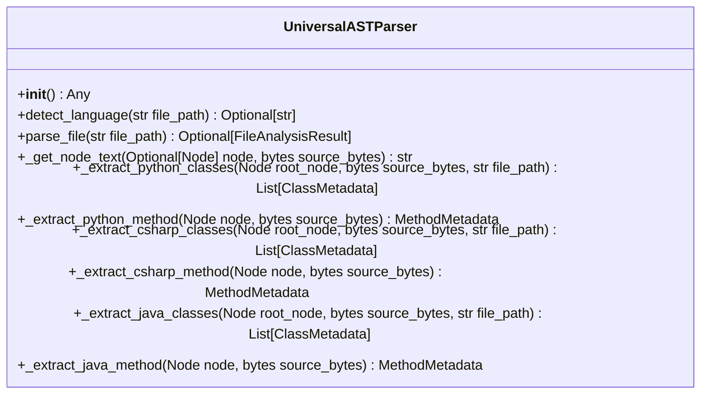

# Class: `UniversalASTParser`

> **Language**: `PYTHON` | **Source**: [`analyzer\parser.py`](../../analyzer\parser.py#L10-L326) | **Lines**: `10 - 326`

---

## 1. Class Architecture Diagram

---

## 2. Overview & Purpose

Provides core abstraction and behaviors for `UniversalASTParser`.

### Why this class exists (Design Rationale)
Encapsulates specialized methods and state within a dedicated class unit.

---

## 3. Key Responsibilities

- Initializes dependencies: None.
- Provides operation `detect_language`.
- Provides operation `parse_file`.
- Provides operation `_get_node_text`.
- Provides operation `_extract_python_classes`.
- Provides operation `_extract_python_method`.
- Provides operation `_extract_csharp_classes`.
- Provides operation `_extract_csharp_method`.
- Provides operation `_extract_java_classes`.
- Provides operation `_extract_java_method`.

---

## 4. Method Signatures & Behavioral Analysis

| Method Name | Parameters | Return Type | Lines | Explanation |
| :--- | :--- | :--- | :--- | :--- |
| **`__init__`** | `self: Any` | `Any` | L11-L35 | Executes method logic. |
| **`detect_language`** | `self: Any`, `file_path: str` | `Optional[str]` | L37-L44 | Executes `detect_language` accepting 2 parameter(s) and returning `Optional[str]`. |
| **`parse_file`** | `self: Any`, `file_path: str` | `Optional[FileAnalysisResult]` | L46-L74 | Executes `parse_file` accepting 2 parameter(s) and returning `Optional[FileAnalysisResult]`. |
| **`_get_node_text`** | `self: Any`, `node: Optional[Node]`, `source_bytes: bytes` | `str` | L76-L79 | Executes `_get_node_text` accepting 3 parameter(s) and returning `str`. |
| **`_extract_python_classes`** | `self: Any`, `root_node: Node`, `source_bytes: bytes`, `file_path: str` | `List[ClassMetadata]` | L82-L134 | Executes `_extract_python_classes` accepting 4 parameter(s) and returning `List[ClassMetadata]`. |
| **`_extract_python_method`** | `self: Any`, `node: Node`, `source_bytes: bytes` | `MethodMetadata` | L136-L172 | Executes `_extract_python_method` accepting 3 parameter(s) and returning `MethodMetadata`. |
| **`_extract_csharp_classes`** | `self: Any`, `root_node: Node`, `source_bytes: bytes`, `file_path: str` | `List[ClassMetadata]` | L175-L225 | Executes `_extract_csharp_classes` accepting 4 parameter(s) and returning `List[ClassMetadata]`. |
| **`_extract_csharp_method`** | `self: Any`, `node: Node`, `source_bytes: bytes` | `MethodMetadata` | L227-L251 | Executes `_extract_csharp_method` accepting 3 parameter(s) and returning `MethodMetadata`. |
| **`_extract_java_classes`** | `self: Any`, `root_node: Node`, `source_bytes: bytes`, `file_path: str` | `List[ClassMetadata]` | L254-L300 | Executes `_extract_java_classes` accepting 4 parameter(s) and returning `List[ClassMetadata]`. |
| **`_extract_java_method`** | `self: Any`, `node: Node`, `source_bytes: bytes` | `MethodMetadata` | L302-L326 | Executes `_extract_java_method` accepting 3 parameter(s) and returning `MethodMetadata`. |

---

## 6. Verifiable Code Citations

- Lines 10-326: Declares `UniversalASTParser` in `analyzer\parser.py`.
- Lines 11-35: Constructor initialization.
- Lines 37-44: Defines method `detect_language`.
- Lines 46-74: Defines method `parse_file`.
- Lines 76-79: Defines method `_get_node_text`.
- Lines 82-134: Defines method `_extract_python_classes`.
- Lines 136-172: Defines method `_extract_python_method`.
- Lines 175-225: Defines method `_extract_csharp_classes`.
- Lines 227-251: Defines method `_extract_csharp_method`.
- Lines 254-300: Defines method `_extract_java_classes`.
- Lines 302-326: Defines method `_extract_java_method`.

---

## 7. Known Architectural Boundaries & Limitations

- ⚠️ End-to-end integration requires inspecting classes calling or referenced by `UniversalASTParser`.
- ⚠️ Underlying data persistence and network latency characteristics depend on external runtime configuration.

---
*Auto-generated by GitHub Pipeline Code Documentation Engine.*
