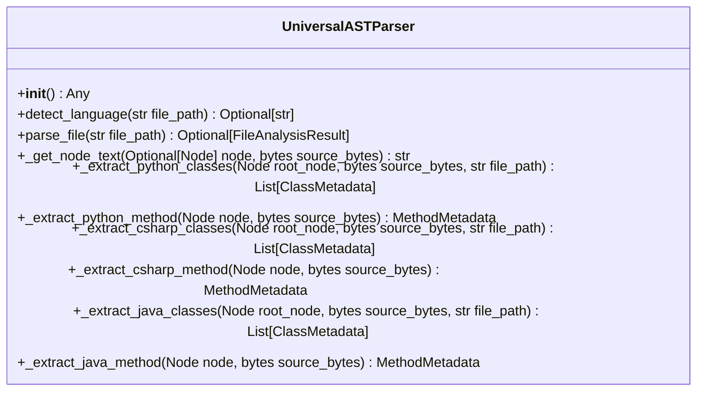

# Class: `UniversalASTParser`

> **Language**: `PYTHON` | **Engine**: `GROUNDED_HEURISTIC` | **Source**: [`analyzer/parser.py`](../../analyzer/parser.py#L28-L392) | **Lines**: `28 - 392`

---

## 1. Class Architecture Diagram

---

## 2. Overview & Purpose

Orchestrates grammar loading and syntax tree traversal across multiple languages.

### Why this class exists (Design Rationale)
Encapsulates specialized methods and state within a dedicated class unit adhering to single responsibility principles.

---

## 3. Key Responsibilities

- Initializes instance dependencies: None.
- Provides operation `detect_language`.
- Provides operation `parse_file`.
- Provides operation `_get_node_text`.
- Provides operation `_extract_python_classes`.
- Provides operation `_extract_python_method`.
- Provides operation `_extract_csharp_classes`.
- Provides operation `_extract_csharp_method`.
- Provides operation `_extract_java_classes`.
- Provides operation `_extract_java_method`.

---

## 4. Method Signatures & Behavioral Analysis

| Method Name | Parameters | Return Type | Lines | Explanation |
| :--- | :--- | :--- | :--- | :--- |
| **`__init__`** | `self: Any` | `Any` | L33-L59 | Initializes language grammars and parser instances for supported languages. |
| **`detect_language`** | `self: Any`, `file_path: str` | `Optional[str]` | L61-L77 | Maps a file extension to its corresponding parser language key.
        
        Args:
            file_path: Relative or absolute path to the file.
            
        Returns:
            Language string ('python', 'csharp', 'java') or None if unsupported. |
| **`parse_file`** | `self: Any`, `file_path: str` | `Optional[FileAnalysisResult]` | L79-L117 | Reads a source file, parses its AST, and extracts structured class metadata.
        
        Args:
            file_path: Path to the target source file.
            
        Returns:
            FileAnalysisResult containing discovered classes, or None if unparseable. |
| **`_get_node_text`** | `self: Any`, `node: Optional[Node]`, `source_bytes: bytes` | `str` | L119-L123 | Helper to extract and decode substring bounded by a Tree-sitter node. |
| **`_extract_python_classes`** | `self: Any`, `root_node: Node`, `source_bytes: bytes`, `file_path: str` | `List[ClassMetadata]` | L128-L185 | Traverses Python AST to extract classes, bases, dependencies, and methods. |
| **`_extract_python_method`** | `self: Any`, `node: Node`, `source_bytes: bytes` | `MethodMetadata` | L187-L226 | Parses a Python function_definition node into structured MethodMetadata. |
| **`_extract_csharp_classes`** | `self: Any`, `root_node: Node`, `source_bytes: bytes`, `file_path: str` | `List[ClassMetadata]` | L231-L284 | Traverses C# AST extracting classes, interfaces, base_list, and DI constructors. |
| **`_extract_csharp_method`** | `self: Any`, `node: Node`, `source_bytes: bytes` | `MethodMetadata` | L286-L311 | Parses a C# method_declaration node into MethodMetadata. |
| **`_extract_java_classes`** | `self: Any`, `root_node: Node`, `source_bytes: bytes`, `file_path: str` | `List[ClassMetadata]` | L316-L365 | Traverses Java AST extracting classes, interfaces, superclasses, and methods. |
| **`_extract_java_method`** | `self: Any`, `node: Node`, `source_bytes: bytes` | `MethodMetadata` | L367-L392 | Parses a Java method_declaration node into MethodMetadata. |

---

## 6. Verifiable Code Citations

- Lines 28-392: Declares `UniversalASTParser` in `analyzer/parser.py`.
- Lines 33-59: Constructor initialization.
- Lines 61-77: Defines method `detect_language`.
- Lines 79-117: Defines method `parse_file`.
- Lines 119-123: Defines method `_get_node_text`.
- Lines 128-185: Defines method `_extract_python_classes`.
- Lines 187-226: Defines method `_extract_python_method`.
- Lines 231-284: Defines method `_extract_csharp_classes`.
- Lines 286-311: Defines method `_extract_csharp_method`.
- Lines 316-365: Defines method `_extract_java_classes`.
- Lines 367-392: Defines method `_extract_java_method`.

---

## 7. Known Architectural Boundaries & Limitations

- ⚠️ End-to-end integration requires inspecting classes calling or referenced by `UniversalASTParser`.
- ⚠️ Underlying data persistence and network latency characteristics depend on external runtime configuration.

---
*Auto-generated by GitHub Pipeline Code Documentation Engine.*
