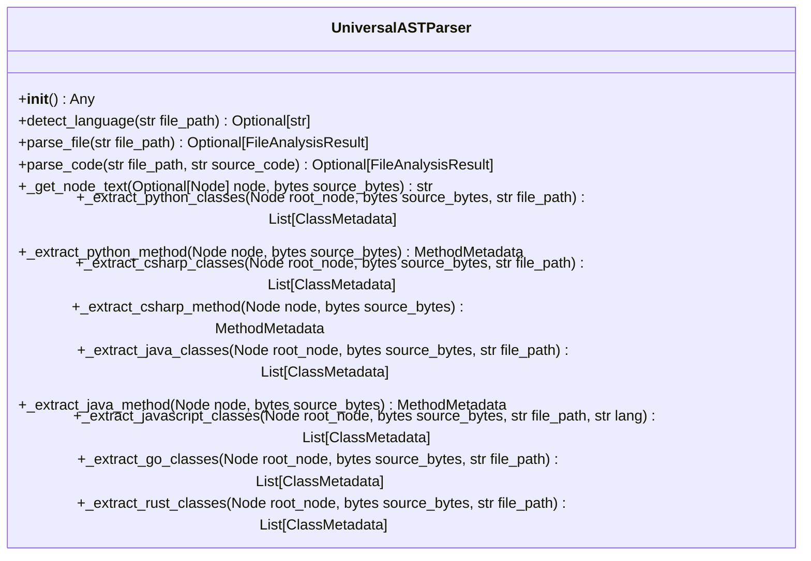

# Class: `UniversalASTParser`

> **Language**: `PYTHON` | **Engine**: `GEMINI` | **Source**: [`analyzer/parser.py`](../../analyzer/parser.py#L48-L762) | **Lines**: `48 - 762`

---

## 1. Overview & Architectural Purpose

Orchestrates multi-language grammar loading and AST traversal to extract structured metadata (classes, interfaces, structs, components, methods, fields, and dependencies) across Python, C#, Java, JavaScript, TypeScript, TSX, Go, and Rust source files.

### Design Rationale
OBSERVED: Operates as a centralized facade over Tree-sitter parsers, organizing language-specific extraction logic into isolated private helper methods (`_extract_<lang>_classes`). INFERRED: Designed to provide a single, consistent API interface (`parse_code` / `parse_file`) returning uniform data models (`FileAnalysisResult`) regardless of the underlying source code language.

---

## 2. Key Responsibilities & Capabilities

- Initialize and maintain Tree-sitter Language and Parser instances for supported programming languages upon instantiation.
- Map source file extensions to language identifiers.
- Read and convert file contents or source code strings into Tree-sitter AST representations.
- Traverse language-specific AST structures to extract class metadata, interface implementations, struct definitions, React functional components, constructors, dependencies, and methods.

---

## 3. Method Signatures & Behavioral Analysis

| Method Name | Parameters | Return Type | Lines | Explanation |
| :--- | :--- | :--- | :--- | :--- |
| **`__init__`** | `self: Any` | `Any` | L54-L117 | Attempts to load grammar definitions and instantiate Tree-sitter Parser objects for Python, C#, Java, JavaScript, TypeScript, TSX, Go, and Rust into `self.parsers` dictionary, swallowing initialization exceptions with warning prints. |
| **`detect_language`** | `self: Any`, `file_path: str` | `Optional[str]` | L119-L137 | Receives a file path string, extracts its extension, and maps it to a language key (e.g., '.py' -> 'python', '.rs' -> 'rust'). Returns None if unsupported. |
| **`parse_file`** | `self: Any`, `file_path: str` | `Optional[FileAnalysisResult]` | L139-L150 | Reads text from `file_path` with UTF-8 encoding (replacing encoding errors) and delegates parsing to `parse_code`. |
| **`parse_code`** | `self: Any`, `file_path: str`, `source_code: str` | `Optional[FileAnalysisResult]` | L152-L183 | Encodes source text to bytes, retrieves the appropriate Tree-sitter parser, generates the AST, calls the relevant language-specific extraction method, and returns a `FileAnalysisResult` instance. |
| **`_get_node_text`** | `self: Any`, `node: Optional[Node]`, `source_bytes: bytes` | `str` | L185-L189 | Extracts and decodes the UTF-8 substring corresponding to a Tree-sitter node's `start_byte` and `end_byte` bounds in `source_bytes`. |
| **`_extract_python_classes`** | `self: Any`, `root_node: Node`, `source_bytes: bytes`, `file_path: str` | `List[ClassMetadata]` | L194-L251 | Traverses Python AST `class_definition` nodes to extract class name, superclasses, top-level docstrings, methods, and `__init__` constructor parameter dependencies. |
| **`_extract_python_method`** | `self: Any`, `node: Node`, `source_bytes: bytes` | `MethodMetadata` | L253-L292 | Parses Python `function_definition` nodes into `MethodMetadata`, capturing name, return type hints, parameters, docstrings, and async modifier. |
| **`_extract_csharp_classes`** | `self: Any`, `root_node: Node`, `source_bytes: bytes`, `file_path: str` | `List[ClassMetadata]` | L297-L350 | Traverses C# AST `class_declaration`, `interface_declaration`, and `record_declaration` nodes, capturing `base_list` inheritance, constructor parameter dependencies, up to 10 fields, and methods. |
| **`_extract_csharp_method`** | `self: Any`, `node: Node`, `source_bytes: bytes` | `MethodMetadata` | L352-L377 | Parses C# `method_declaration` nodes into `MethodMetadata` capturing name, return type, and typed parameters. |
| **`_extract_java_classes`** | `self: Any`, `root_node: Node`, `source_bytes: bytes`, `file_path: str` | `List[ClassMetadata]` | L382-L431 | Traverses Java AST `class_declaration`, `interface_declaration`, and `record_declaration` nodes, extracting superclass/interfaces, formal constructor parameter dependencies, and methods. |
| **`_extract_java_method`** | `self: Any`, `node: Node`, `source_bytes: bytes` | `MethodMetadata` | L433-L458 | Parses Java `method_declaration` nodes into `MethodMetadata` with parameter types and names. |
| **`_extract_javascript_classes`** | `self: Any`, `root_node: Node`, `source_bytes: bytes`, `file_path: str`, `lang: str` | `List[ClassMetadata]` | L463-L602 | Traverses JS/TS/JSX/TSX ASTs to extract ES6/TS classes, interface declarations, and React functional components (identified by capitalized function names or arrow function declarators). |
| **`_extract_go_classes`** | `self: Any`, `root_node: Node`, `source_bytes: bytes`, `file_path: str` | `List[ClassMetadata]` | L607-L684 | Traverses Go AST `type_declaration` nodes for struct fields and maps Go `method_declaration` receiver types back to their matching struct definitions. |
| **`_extract_rust_classes`** | `self: Any`, `root_node: Node`, `source_bytes: bytes`, `file_path: str` | `List[ClassMetadata]` | L689-L762 | Traverses Rust AST `struct_item` declarations and links `function_item` methods declared inside corresponding `impl_item` blocks. |

---

## 5. Verifiable Code Citations

- Lines 54-106: `__init__` populates `self.parsers` dictionary with language parsers.
- Lines 108-126: `detect_language` performs dictionary lookup matching file extensions.
- Lines 128-139: `parse_file` opens file with replace error handling and calls `parse_code`.
- Lines 141-171: `parse_code` dispatches tree parsing based on language key and returns `FileAnalysisResult`.
- Lines 173-177: `_get_node_text` performs slice decoding using `node.start_byte` and `node.end_byte`.
- Lines 182-243: `_extract_python_classes` processes Python classes and `__init__` parameter dependencies.
- Lines 284-332: `_extract_csharp_classes` processes C# AST nodes and truncates fields via `fields[:10]`.
- Lines 433-550: `_extract_javascript_classes` processes ES6 classes, capitalized `function_declaration` nodes, and `arrow_function` lexical declarations.
- Lines 555-635: `_extract_go_classes` correlates `method_declaration` receiver types to struct names.
- Lines 640-721: `_extract_rust_classes` correlates `impl_item` methods to struct names.

---

## 6. Known Architectural Boundaries & Limitations

- ⚠️ In C# class extraction, field/property declarations are explicitly truncated to a maximum of 10 items (`fields[:10]`), ignoring remaining fields on large C# types (Line 324).
- ⚠️ React component detection relies on a naming convention heuristic (checking if `func_name[0].isupper()`), which may misidentify standard capitalized utility functions as React UI components or miss non-capitalized component patterns (Lines 492, 532).
- ⚠️ Initialization warnings are logged to stdout (`print`), but missing language modules fail gracefully by withholding keys from `self.parsers`. Subsequent calls to `parse_code` for missing languages return `None` without raising an explicit error (Lines 59, 66, 73, 81, 89, 97, 105, 147-148).
- ⚠️ No cross-file symbol resolution, type inferencing, or external import tracing is performed; cross-file analysis requires inspection outside this class.

---

## 7. Structural Class Diagram (Mermaid)

---
*Auto-generated by Code Documentation Engine.*
